# Введение в компьютерные сети

Сеть связывает устройства через среду передачи. По среде идут сигналы, в которых закодированы данные. От направления передачи и числа получателей зависят режим линии и тип адресации.

## Режимы линии

- **Simplex.** Поток идёт только в одну сторону.
- **Half-duplex.** Обе стороны умеют передавать, но не в один и тот же момент. Общую среду приходится делить по очереди.
- **Full-duplex.** Передача в обе стороны идёт одновременно. Так работает современный коммутируемый Ethernet: механизм CSMA/CD ему уже не нужен.

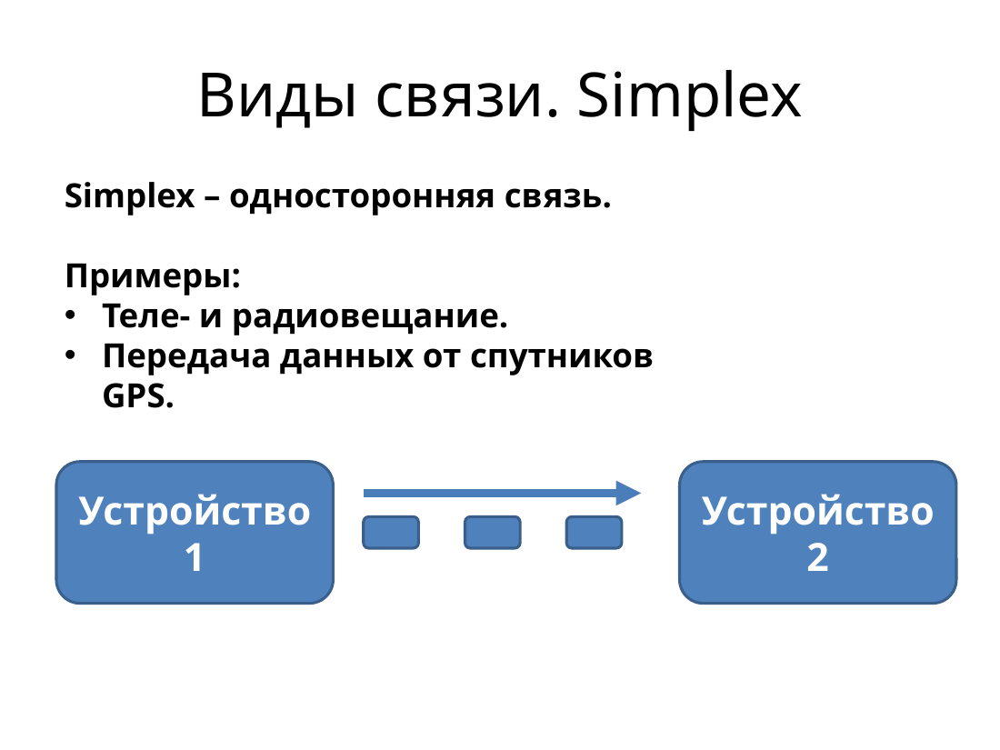

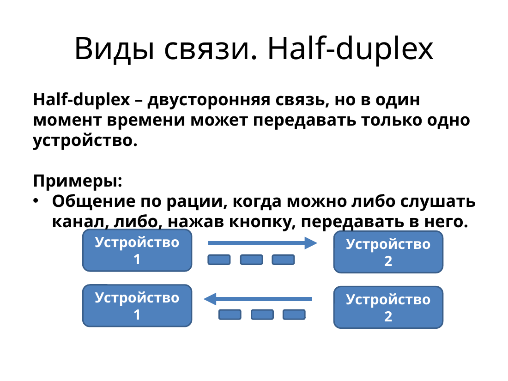

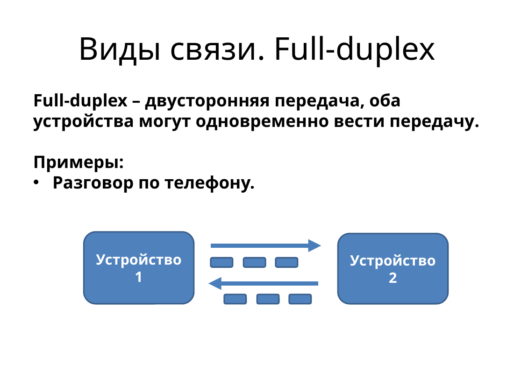

Скорость и дуплекс соседи обычно согласуют сами. Если с одной стороны канал полный, а с другой полудуплекс, скорость обмена падает. Порты Gigabit Ethernet работают только в полном дуплексе.

## Кому отправляют данные

- **Unicast** — одному получателю.
- **Broadcast** — всем узлам сегмента.
- **Multicast** — заранее выбранной группе.

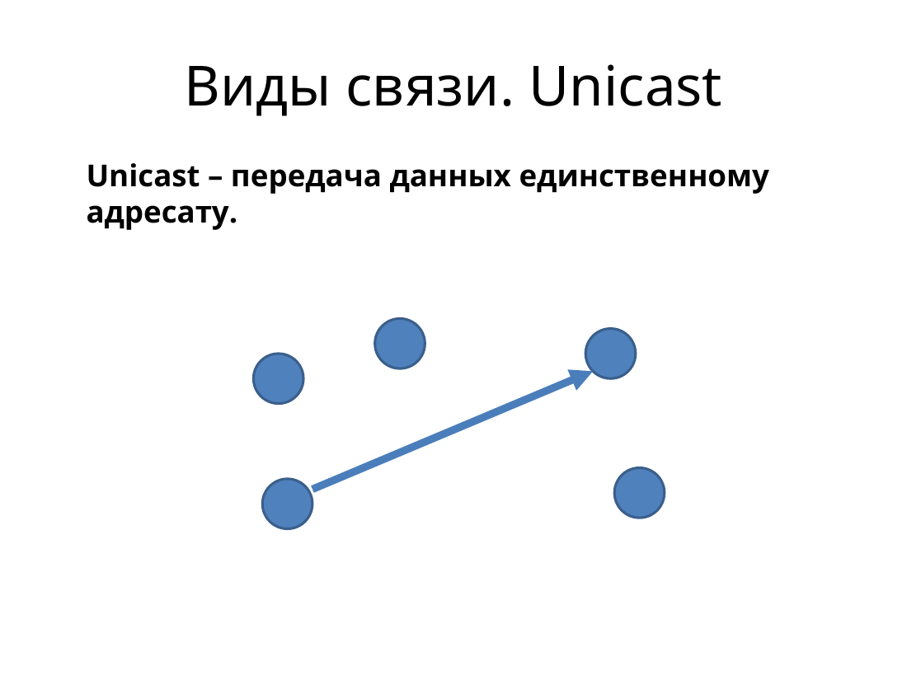

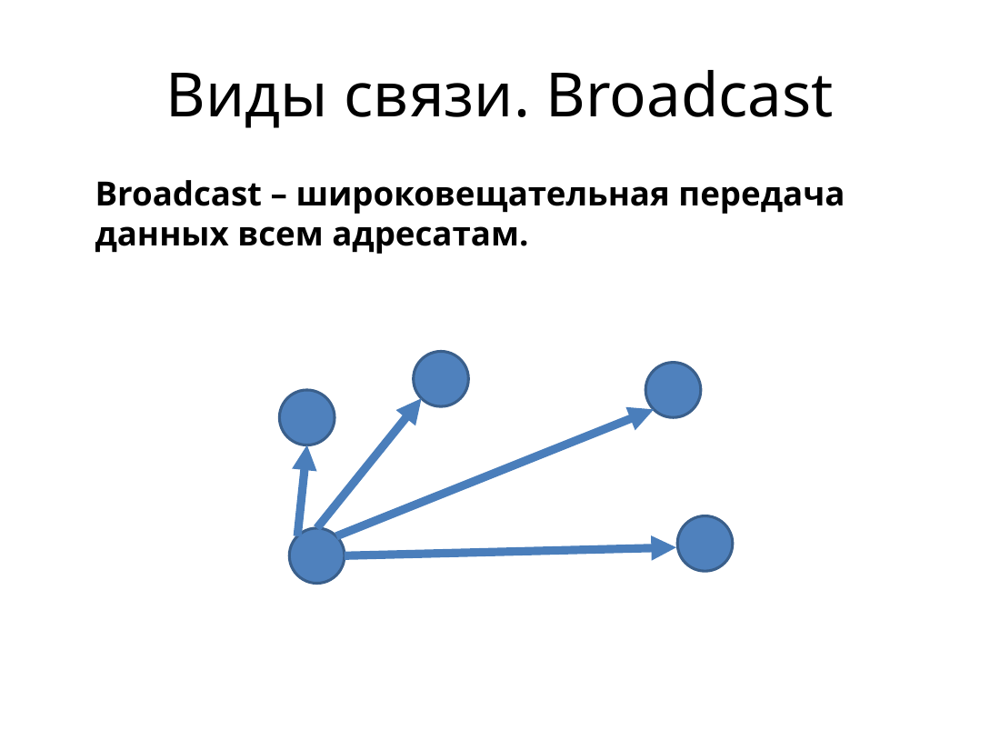

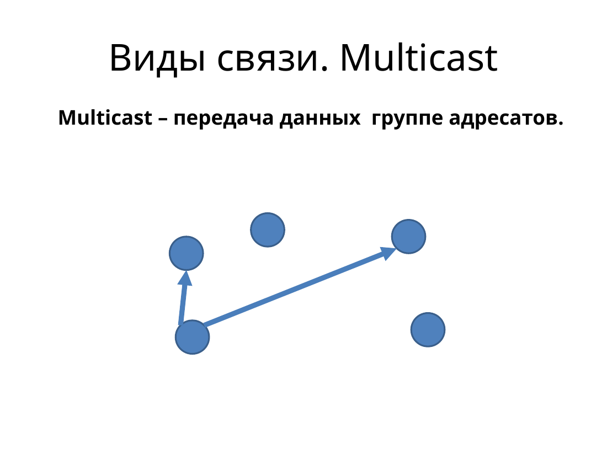

## Охват и коммутация

**LAN** собирает устройства на небольшой территории: комната, этаж, здание. Сети большего масштаба связывают площадки и города. Чем сеть шире, тем важнее общий план адресов и маршрутизация.

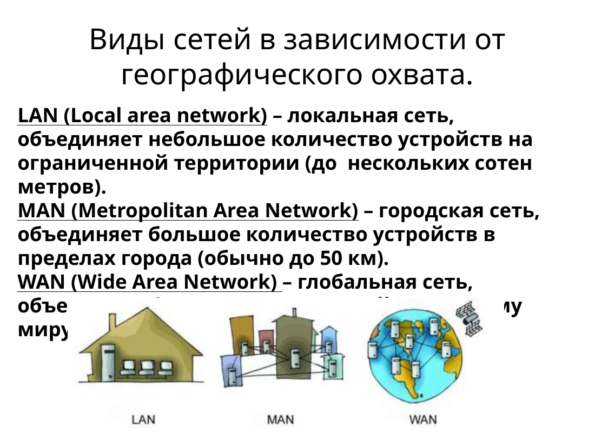

При **коммутации каналов** на время сеанса занимают отдельный путь. Пока сеанс открыт, ресурс занят, даже если в нём много пауз. При **коммутации пакетов** сообщение режут на части. Пакеты разных узлов идут по общим каналам и могут выбирать путь независимо. Так устроен Интернет.

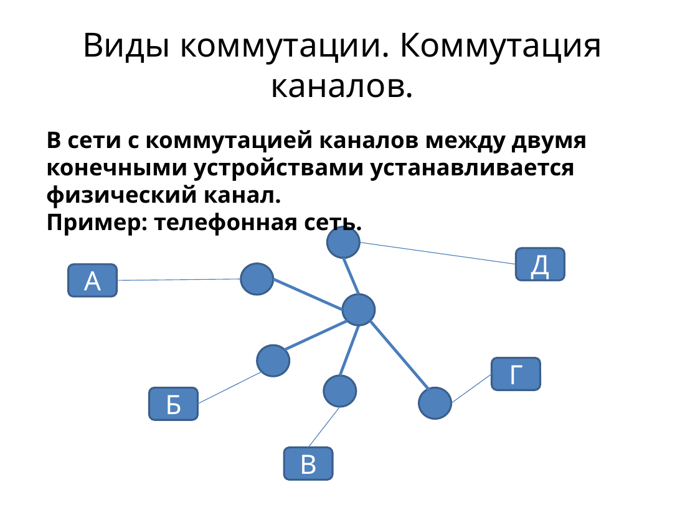

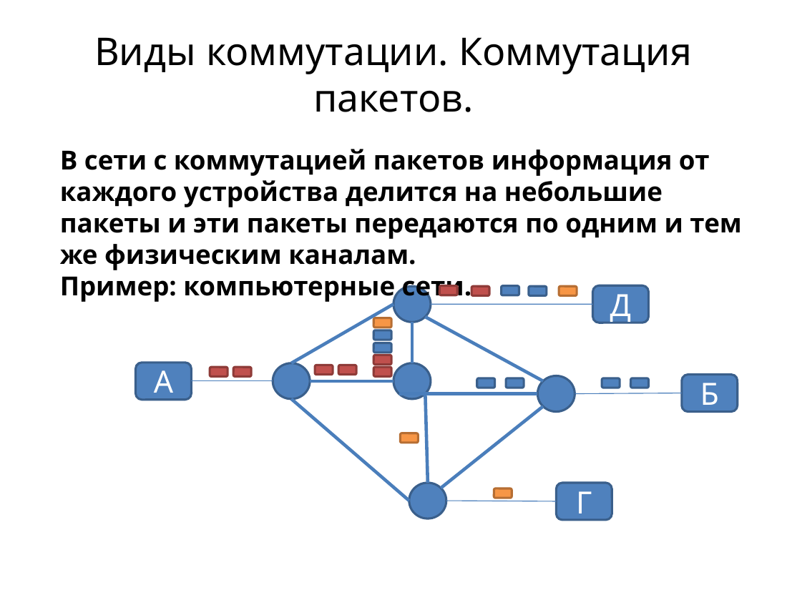

## Зачем делить сеть на уровни

Оборудование разных производителей должно работать вместе. Для этого обмен делят на уровни. Нижний уровень оказывает сервис верхнему, верхний вызывает его через интерфейс, а одинаковые уровни двух устройств говорят по протоколу. Сообщение верхнего уровня становится данными нижнего: к нему добавляют свой заголовок. На приёме заголовки снимают в обратном порядке.

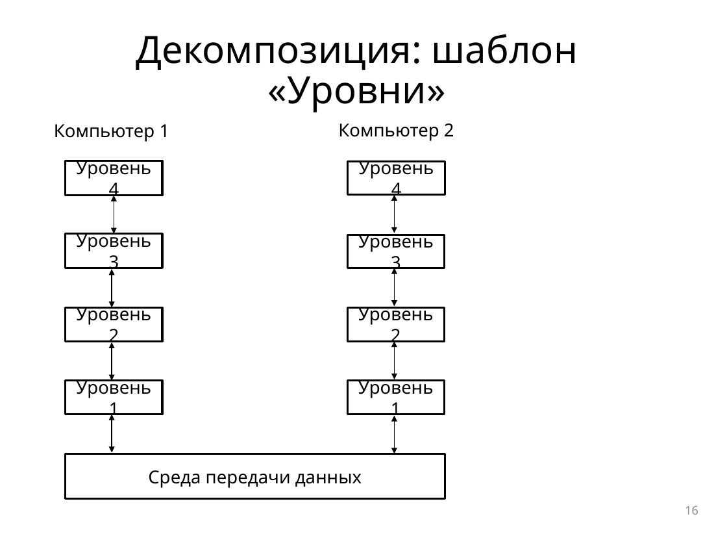

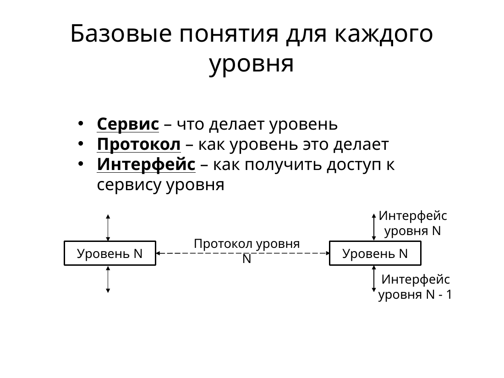

Дальше по курсу идут модель OSI, физическая среда, кадры Ethernet и MAC-адреса, адресация IPv4 и подсети, проверка сети в Packet Tracer, маршрутизация, DHCP, TCP и UDP, NAT и DNS.
