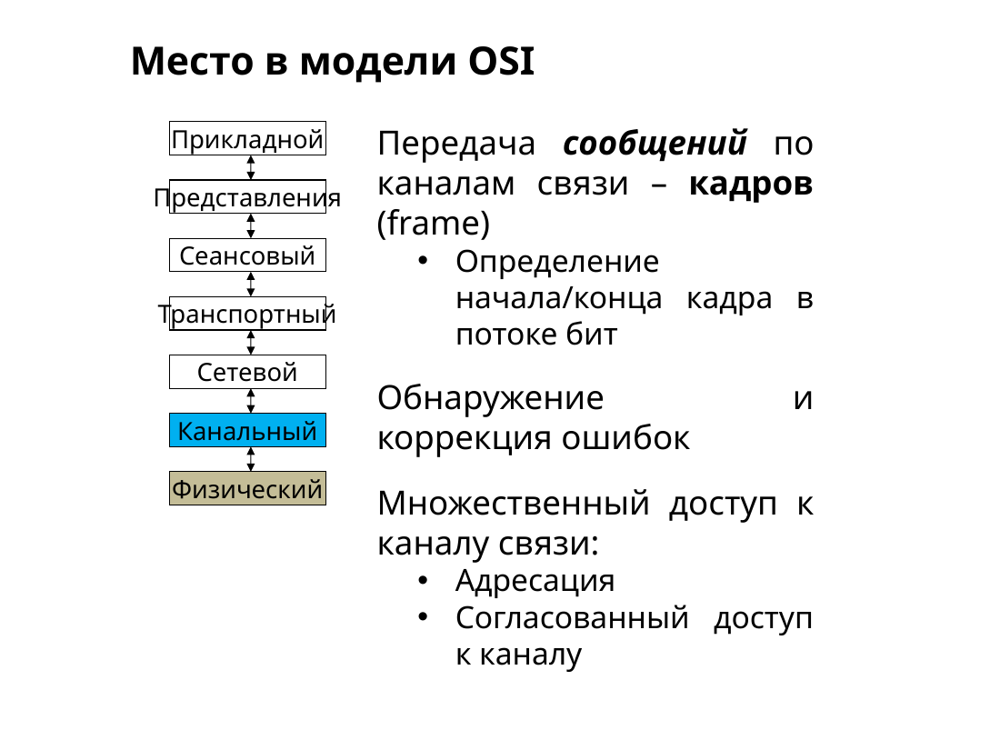
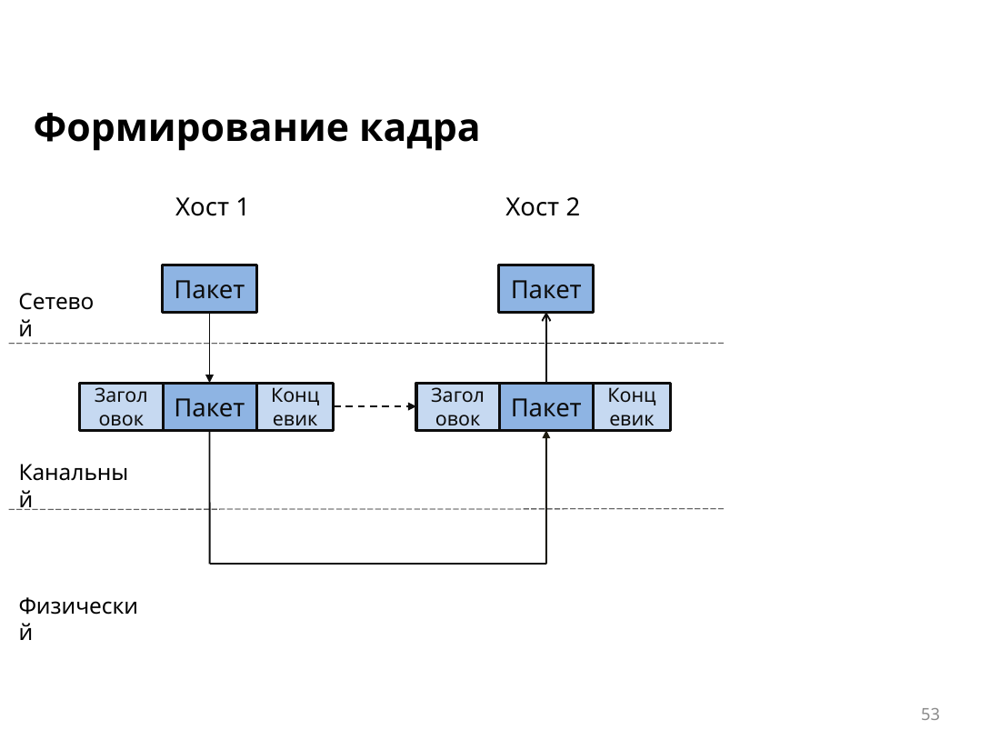

# MAC-адреса

## Кадр Ethernet

Кадр собирают на канальном уровне. В нём есть преамбула и начальный разделитель, MAC-адрес назначения, MAC-адрес источника, поле типа или длины, данные и **FCS**. По FCS приёмник замечает ошибку. Без преамбулы длина кадра от 64 до 1518 байт. Слишком короткий и слишком длинный кадр отбрасывают.

В коммутируемой сети полный дуплекс уже не требует CSMA/CD: коллизия на общей среде остаётся свойством старого полудуплексного Ethernet.

## Формат адреса

MAC-адрес занимает **48 бит (6 байт)** и записывается двенадцатью шестнадцатеричными цифрами, например `00:1A:2B:3C:4D:5E`.

| Часть | Длина | Пример | Кто назначает |
| --- | --- | --- | --- |
| OUI | 24 бита | `00:1A:2B` | производитель |
| Номер интерфейса | 24 бита | `3C:4D:5E` | этот производитель для конкретной платы |

Плата сравнивает адрес назначения со своим. Она также принимает широковещание и групповую рассылку, в которую входит узел.

## Три вида адресов

- **Индивидуальный** указывает на одно устройство. Адрес источника в кадре всегда такой.
- **Широковещательный** `FF-FF-FF-FF-FF-FF` коммутатор отдаёт во все порты, кроме входящего. Маршрутизатор такой кадр в другие сети не пересылает.
- **Групповой** получают несколько узлов. Для IPv4 он начинается с `01-00-5E`, для IPv6 — с `33-33`.

## Таблица коммутатора

Коммутатор второго уровня решает, куда отдать кадр, только по MAC-адресам. Сразу после включения таблица пуста. Коммутатор запоминает адрес источника и порт, откуда кадр пришёл. Если запись уже есть, он обновляет таймер. Обычно запись живёт около пяти минут. Если тот же адрес появился на другом порту, старая запись заменяется.

Известный адрес назначения уходит в один порт. Неизвестный индивидуальный адрес, широковещание и групповая рассылка уходят во все остальные порты. Эту таблицу называют ещё **CAM**.

## Дублирование адресов

Адрес могут клонировать или оставить одинаковым у виртуальных машин. Коммутатор видит один источник то на одном порту, то на другом и переписывает запись. Кадры начинают прыгать между портами. Лечится это уникальными адресами, фильтром MAC и port-security.
