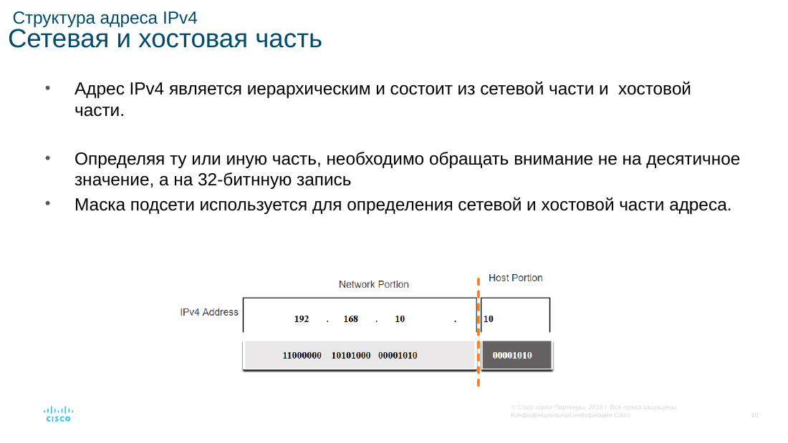
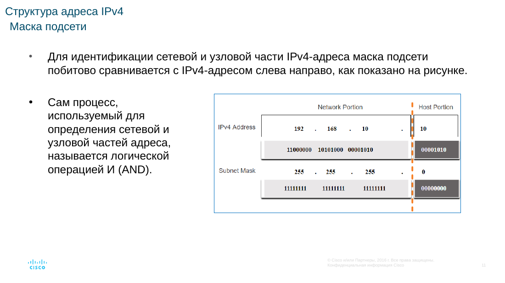
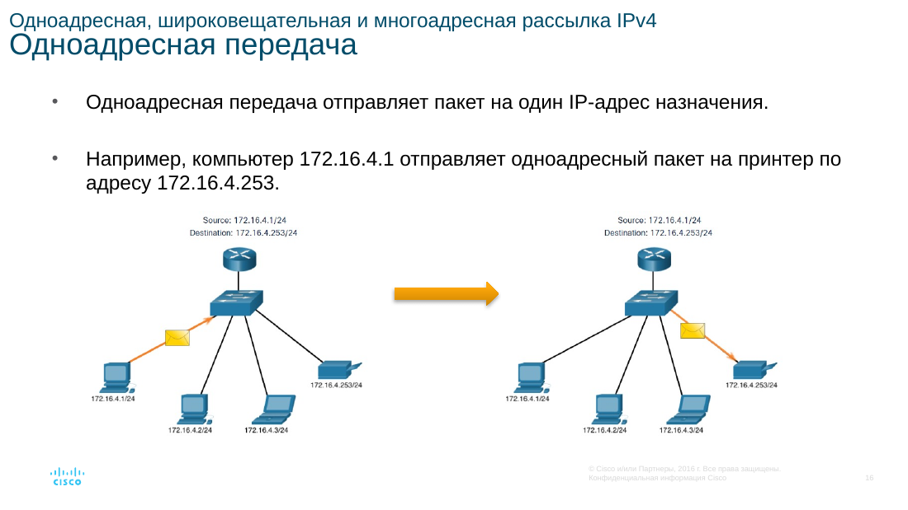
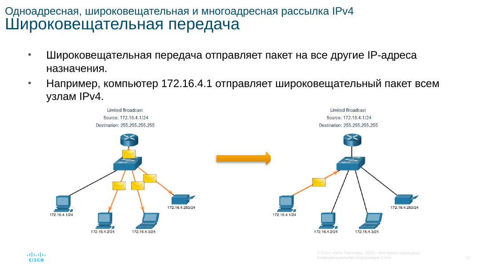
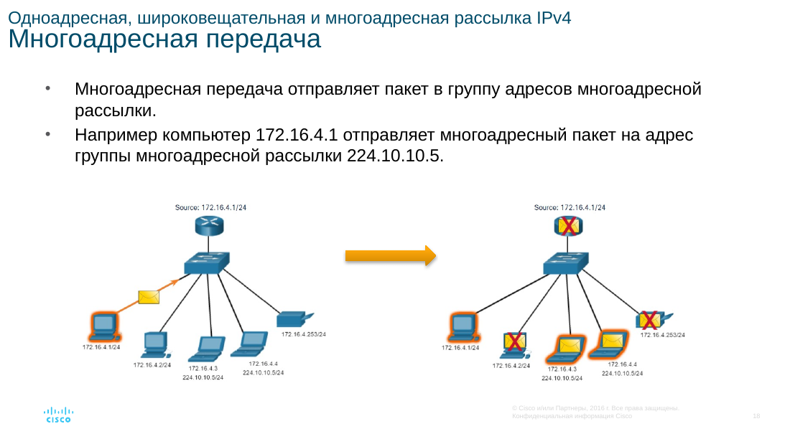
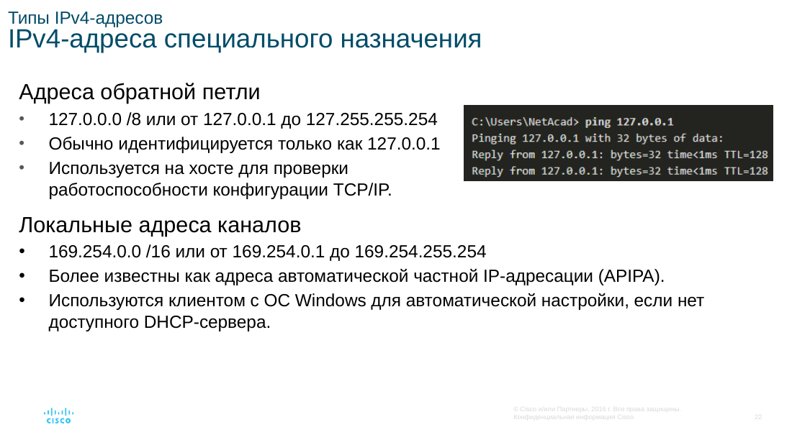
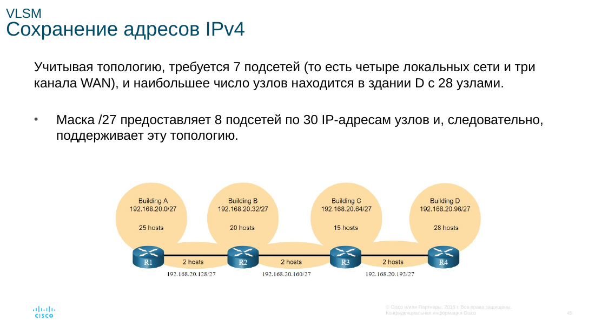
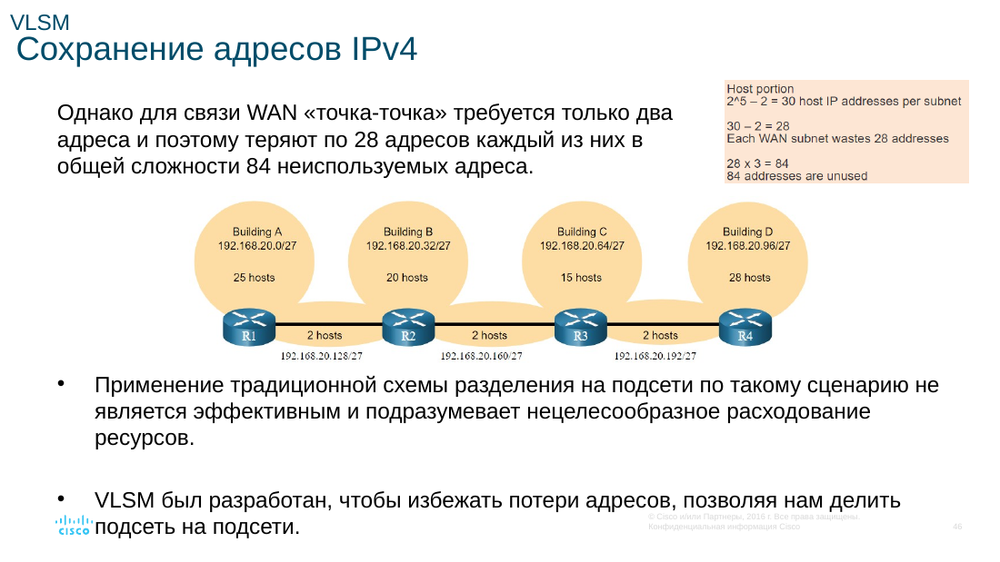
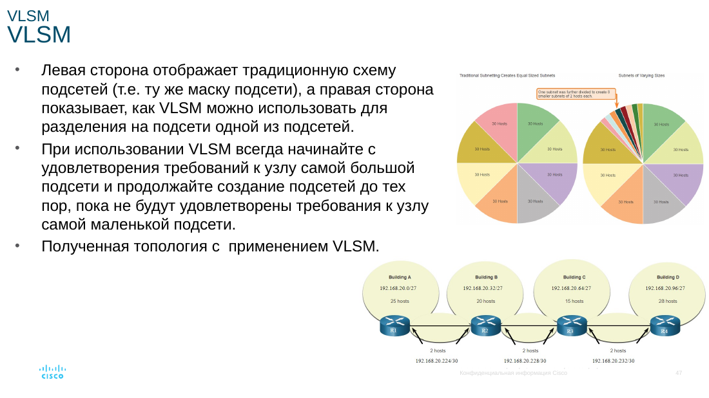

# Адресация IPv4

Адрес IPv4 — 32 бита, четыре десятичных октета. Он иерархический: часть битов задаёт сеть, остальные — узел. Границу показывает маска. Префикс `/24` — то же, что маска `255.255.255.0`: 24 бита сети и 8 битов узла.

Адрес сети получают побитовым **И** между адресом узла и маской. У `192.168.10.10/24` адрес сети — `192.168.10.0`. Широковещательный адрес этой сети — `192.168.10.255`. Узлам оставляют диапазон от `192.168.10.1` до `192.168.10.254`.

## Кому уходит пакет

- **Одноадресная** передача идёт на один адрес.
- **Широковещательная** доходит до всех узлов широковещательного домена.
- **Многоадресная** идёт группе. Пример такого адреса — `224.10.10.5`.

## Публичные, частные и особые адреса

Публичный адрес маршрутизируется в Интернете. Частные диапазоны `10.0.0.0/8`, `172.16.0.0/12` и `192.168.0.0/16` живут внутри организации и наружу сами не маршрутизируются. На границе их обычно переводит NAT.

`127.0.0.1` проверяет стек самого узла. Блок `169.254.0.0/16` узел может занять сам, если DHCP не ответил. Старое деление на классы A, B и C заменили префиксами. Крупные блоки распределяет IANA через региональных регистраторов.

## Подсети

Большую сеть делят, чтобы урезать широковещание. Маршрутизатор не пропускает его в соседнюю сеть. Чем длиннее префикс, тем меньше узлов в подсети. Сеть `/24` можно разрезать на четыре подсети `/26`: в каждой `2^6 - 2 = 62` обычных адреса. Два адреса всегда уходят на сеть и broadcast. Общая формула: `2^(32 − длина префикса) − 2`.

## VLSM

**VLSM** разрешает подсети разного размера в одном плане. Сети до 30 узлов хватает `/27`, каналу между двумя маршрутизаторами — `/30`. Так не тратят целый блок там, где нужны два адреса. Сначала нарезают крупные куски, потом мелкие, чтобы диапазоны не пересеклись.

Перед настройкой считают число подсетей и узлов. Клиентам адреса чаще выдаёт DHCP. Серверам и портам сетевых устройств их назначают постоянно.
