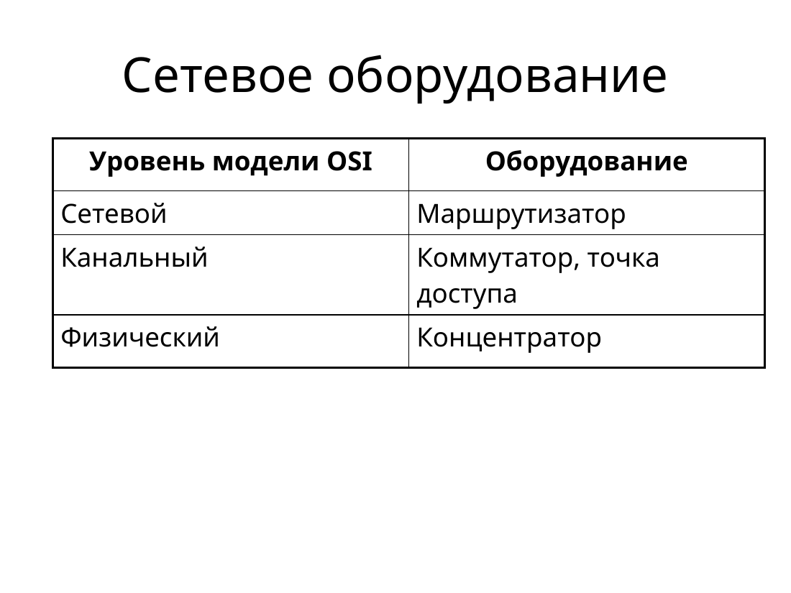
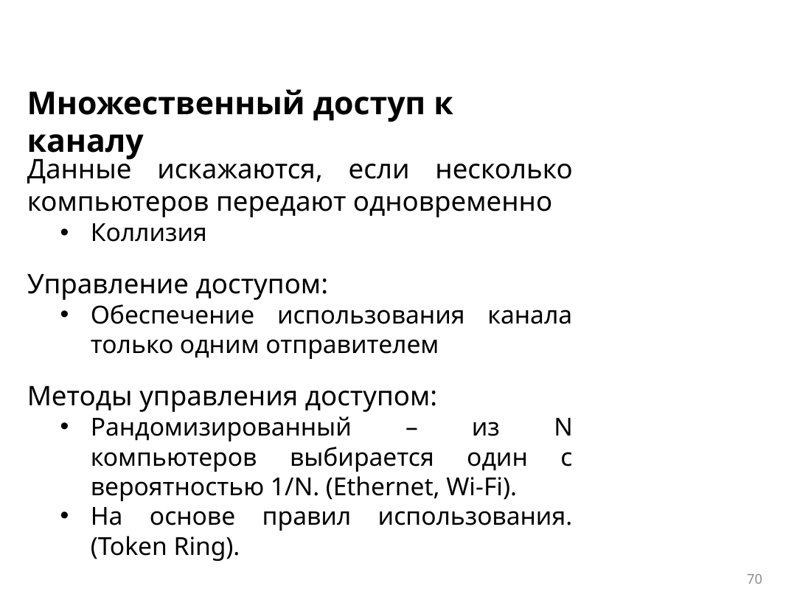

# Коммутаторы, хабы и проверка связи

Хаб повторяет входящий сигнал на остальные порты. Все узлы на нём делят одну среду и один домен коллизий. Коммутатор запоминает MAC-адрес источника и порт, а известный кадр отправляет только нужному порту. Широковещание он по-прежнему отдаёт во все остальные порты, поэтому несколько коммутаторов в одной VLAN остаются одним широковещательным доменом.

Если между двумя коммутаторами стоит хаб, кадр, попавший на хаб, уходит на оба. Для IP-связи без маршрутизатора все компьютеры должны лежать в одной подсети.

## Как коммутатор пересылает кадр

- **С промежуточным хранением.** Коммутатор дочитывает кадр целиком, проверяет CRC и выбрасывает битый кадр. Этот режим нужен, если кадр ещё и классифицируют, например для QoS.
- **Сквозная пересылка.** Отправка начинается сразу после MAC-адреса назначения, не дожидаясь конца кадра. Ошибку CRC так не поймать.
- **Быстрая пересылка.** Это сквозной режим с самой маленькой задержкой.
- **С отсечением фрагментов.** Перед отправкой смотрят первые 64 байта, чтобы отбросить обломки коллизий.

## Буфер

При буфере на портах кадры стоят в очередях входа и выхода. Занятый порт назначения задерживает и остальные кадры своей очереди. При общей памяти все кадры лежат в одном буфере, и память делят между портами по потребности. Это удобно, когда скорости портов разные.

## Дуплекс

Полный дуплекс передаёт в обе стороны сразу, полудуплекс — только в одну. Если концы кабеля согласованы по-разному, канал заметно хуже. Автоопределение должно быть включено с обеих сторон или выключено с обеих. **Auto-MDIX** сам выбирает раскладку пар. На Cisco его включает `mdix auto`.

## Ping и симуляция

`ping` шлёт эхо-запрос ICMP и ждёт эхо-ответ. Четыре ответа без потерь значат, что адрес достижим, ARP уже решён и кадры ходят в обе стороны. Нулевое время в Packet Tracer обычно значит, что задержку модели не задавали.

В симуляции пакет проводят по шагам. В списке событий видно устройство, время и то, как кадр проходит коммутатор или хаб. Так проверяют, что хаб размножает кадр, а коммутатор после обучения шлёт его в один порт.

