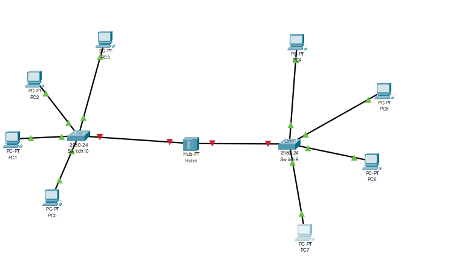
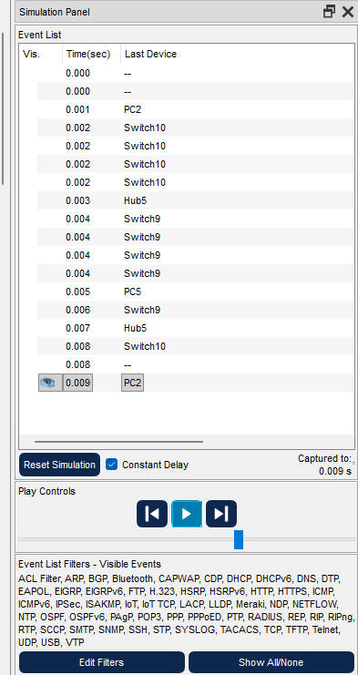

# Домашнее задание 23.09

Урок 6. Собрать в Cisco Packet Tracer сеть из компьютеров на двух коммутаторах с хабом между ними, проверить связь командой `ping` и посмотреть прохождение кадра в симуляции.

По этой домашке сделан конспект: [Коммутаторы, хабы и проверка связи](<../class/Коммутаторы хабы и проверка связи.md>).

## Схема

На схеме восемь компьютеров: часть на Switch10, часть на Switch9, между коммутаторами Hub5.

## Ping

С PC3 выполнен `ping 192.168.1.3`: четыре ответа, потерь нет.

## Симуляция

В списке событий кадр проходит PC2, Switch10, Hub5, Switch9 и возвращается.

