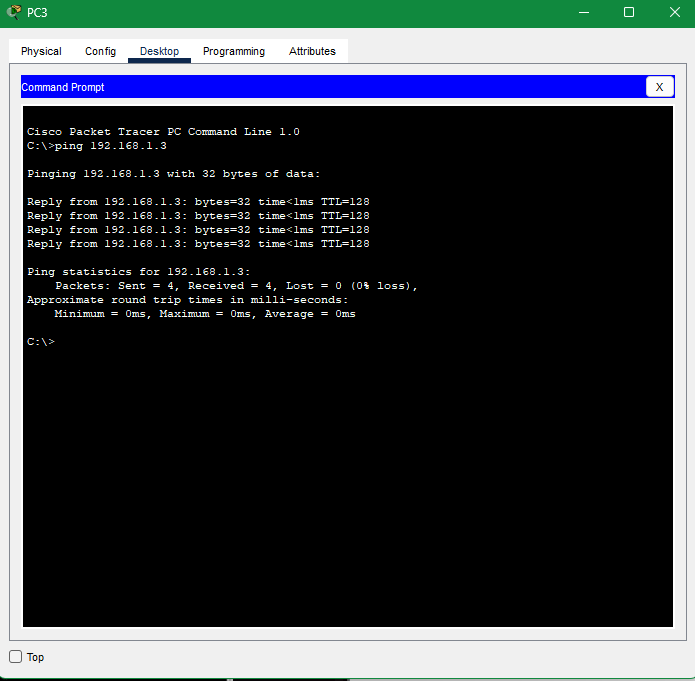

# Домашнее задание №6

Сеть в Cisco Packet Tracer: компьютеры на двух коммутаторах, между коммутаторами стоит хаб.

## Схема сети

## Проверка ping

С PC3 выполнен ping до 192.168.1.3: четыре ответа, потерь нет.

## Режим симуляции

Исходные файлы: `homework/homework 23.09/`.
