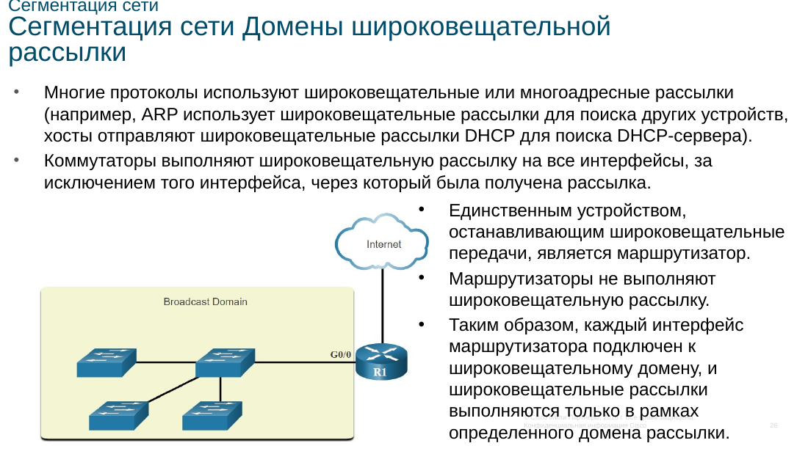
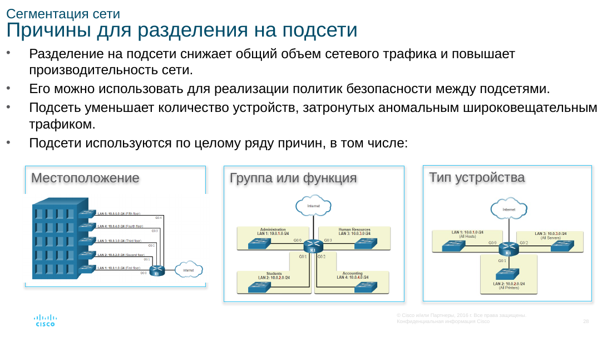
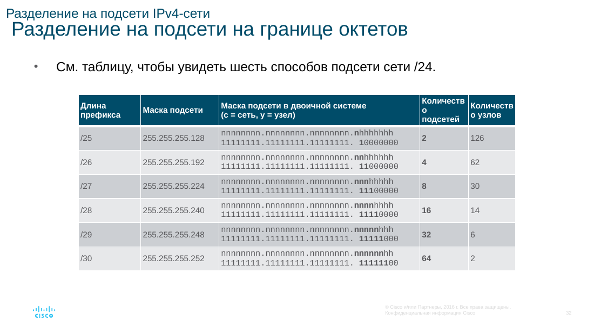

# Разделение сети на подсети

Из хостовой части забирают несколько старших битов и отдают их номеру подсети. Число равных подсетей — `2^n`, где `n` — число занятых битов. Число адресов в подсети — `2^h`, где `h` — оставшиеся биты хоста. Рабочих адресов на два меньше: адрес сети и broadcast не назначают узлам.

Новый префикс равен старому плюс `n`. Маску читают по единицам в двоичной записи. Шаг в последнем затронутом октете — размер блока, степень двойки.

## Как подобрать префикс

1. Решить, что важнее: число подсетей или число узлов.
2. Если заданы подсети, найти минимальное `n`, при котором `2^n` не меньше нужного числа.
3. Если заданы узлы, найти минимальное `h`, при котором `2^h - 2` покрывает узлы и шлюз.
4. Проверить, что оба ограничения помещаются в исходный блок. Если нет, берут более короткий исходный префикс.

Ровно три или шесть равных подсетей из одного блока получить нельзя: равное деление даёт степень двойки. Берут ближайшую большую степень и лишние подсети оставляют про запас.

Одинаковая маска проста, но на канале между двумя маршрутизаторами тратит адреса. **VLSM** разрешает разные префиксы. Сначала нарезают крупные подсети, затем из остатка — мелкие.

## Сеть 192.168.1.0/24 на четыре равные части

Чтобы получить четыре подсети, занимают 2 бита: `2^2 = 4`. Префикс становится `/26`, маска `255.255.255.192` (`128 + 64 = 192`). Шаг — `2^(32-26) = 64` адреса, рабочих узлов — `64 - 2 = 62`.

| Подсеть | Адрес сети | Рабочие адреса | Broadcast |
| --- | --- | --- | --- |
| 1 | 192.168.1.0/26 | 192.168.1.1–192.168.1.62 | 192.168.1.63 |
| 2 | 192.168.1.64/26 | 192.168.1.65–192.168.1.126 | 192.168.1.127 |
| 3 | 192.168.1.128/26 | 192.168.1.129–192.168.1.190 | 192.168.1.191 |
| 4 | 192.168.1.192/26 | 192.168.1.193–192.168.1.254 | 192.168.1.255 |

## Пятьдесят узлов в сети 192.168.10.0/24

С двумя служебными адресами нужно не меньше 52 мест. Ближайший блок — `2^6 = 64`, значит хостовых битов шесть, префикс `/26`, маска `255.255.255.192`. Из `/24` забрали 2 бита, подсетей вышло `2^2 = 4`. Адреса те же по форме, что в прошлой таблице, только третий октет равен 10: `192.168.10.0/26`, `.64/26`, `.128/26` и `.192/26`.

Серверам и интерфейсам маршрутизаторов адреса назначают постоянно. Обычным клиентам их может выдавать DHCP.
