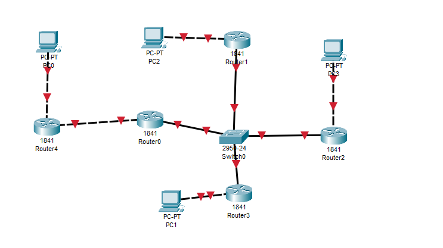
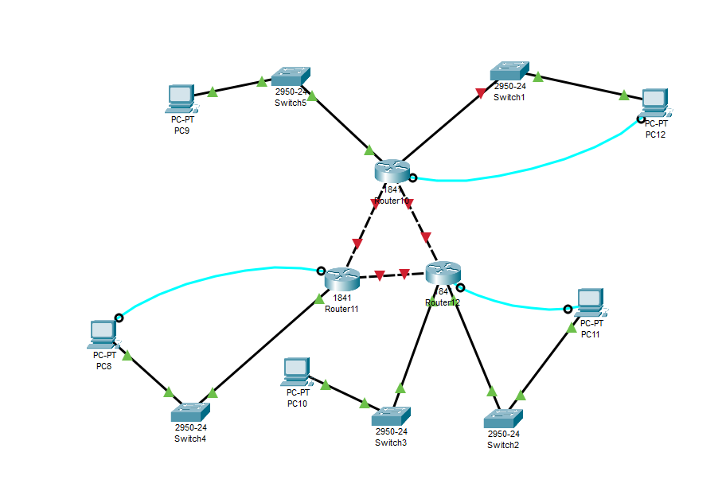

# Домашнее задание №8

Три схемы маршрутизации в Cisco Packet Tracer.

## Маршрутизаторы и коммутатор

## Маршрутизаторы и хабы

## Треугольник из маршрутизаторов

Конспект-презентация: [маршрут.ppt](<../class/маршрут.ppt>).

Исходные файлы: `homework/homework 30.09/`.
