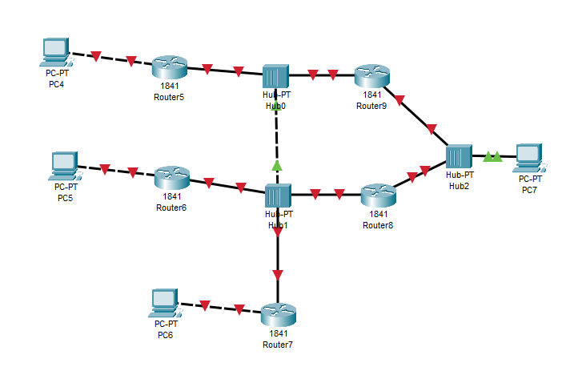

# Домашнее задание 30.09

Урок 9. Три схемы маршрутизации в Cisco Packet Tracer.

## Маршрутизаторы и коммутатор

Пять маршрутизаторов и коммутатор в центре. У части маршрутизаторов свой компьютер.

## Маршрутизаторы и хабы

Шесть маршрутизаторов с компьютерами сходятся к хабам.

## Треугольник маршрутизаторов

Три маршрутизатора соединены между собой. У каждого свои коммутаторы и компьютеры.

