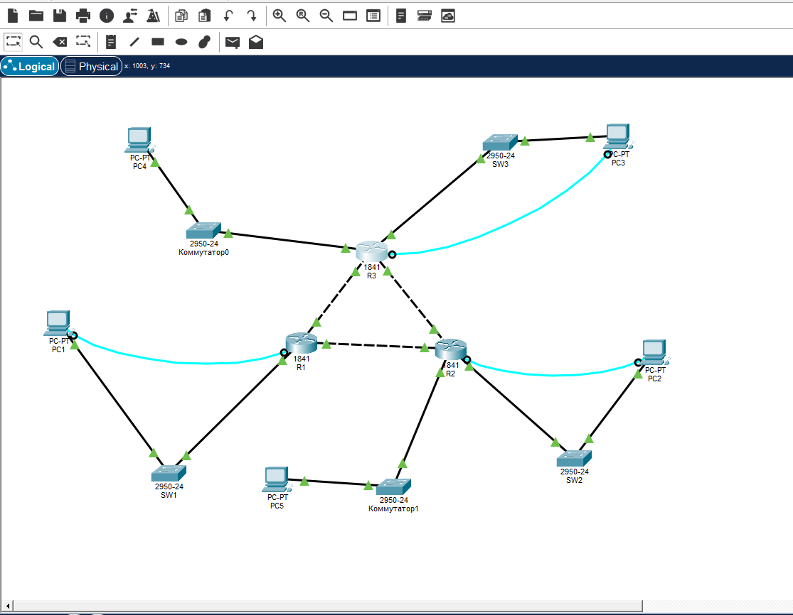

# Домашнее задание урока 10

К уроку 10 относятся две сдачи: схема от 5.10 и конспект DHCP от 7.10.

## 5.10. Схема из трёх маршрутизаторов

Три маршрутизатора 1841 соединены последовательно. У каждого свой сегмент с коммутатором и компьютерами.

## 7.10. Конспект DHCP

По этой домашке сделан конспект: [Протокол DHCP](<../class/Протокол DHCP.md>).

DHCP автоматически выдаёт интерфейсу IP-адрес, маску, шлюз и DNS и не даёт выдать один адрес двум узлам.

Кратко по сдаче:

- До DHCP были RARP и BOOTP. RARP не передавал маску и шлюз и требовал сервер в каждом сегменте. BOOTP добавил relay, но таблицы всё ещё вели вручную. DHCP — совместимое расширение BOOTP.
- Режимы: ручная привязка к MAC, автоматическая постоянная выдача и динамическая аренда. На аренде пул из 64 адресов может обслужить больше людей, если они не сидят в сети одновременно.
- Четыре сообщения: поиск, предложение, запрос, квитанция. Без сервера в подсети запрос уносит relay.
- Динамический адрес плохо стыкуется с обычным DNS, мониторингом и фильтрами. Серверам, маршрутизаторам и принтерам оставляют статические адреса.
