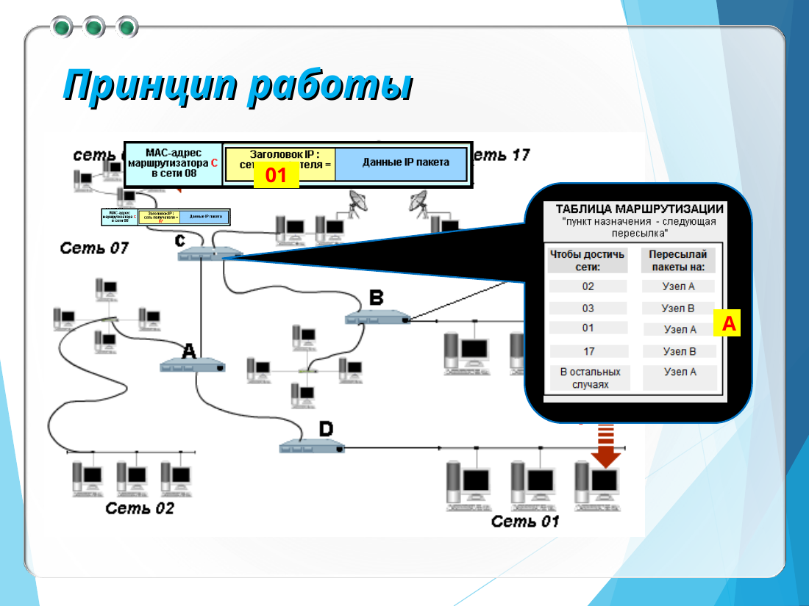
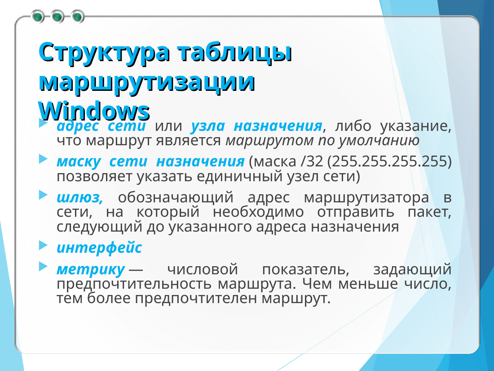
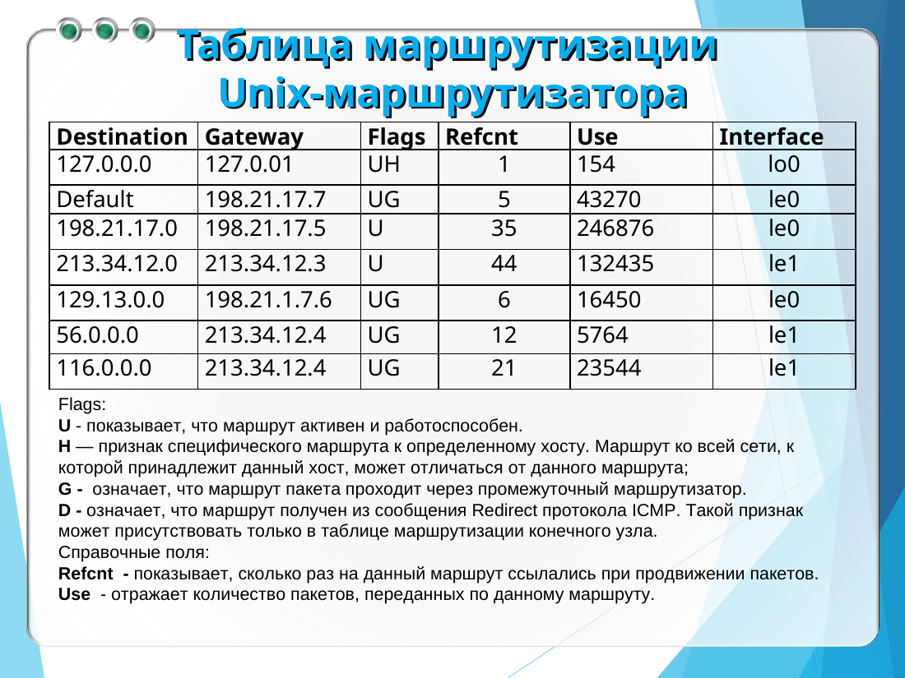
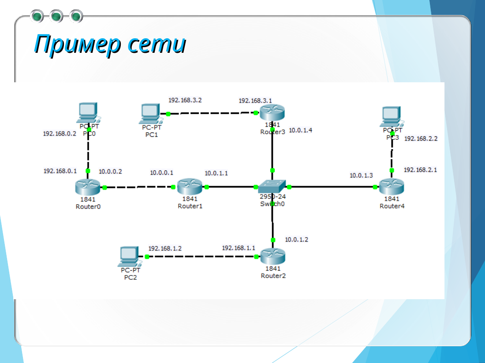
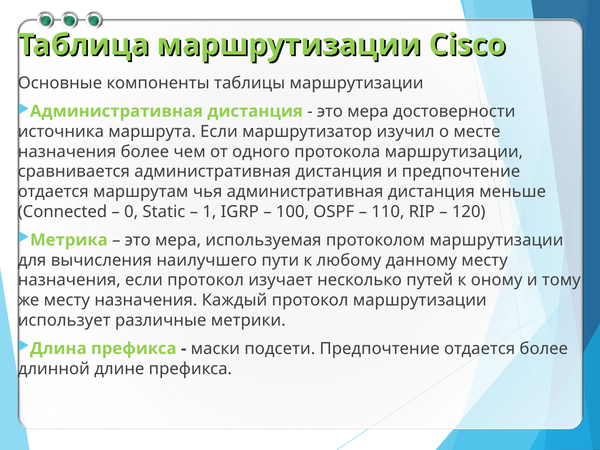
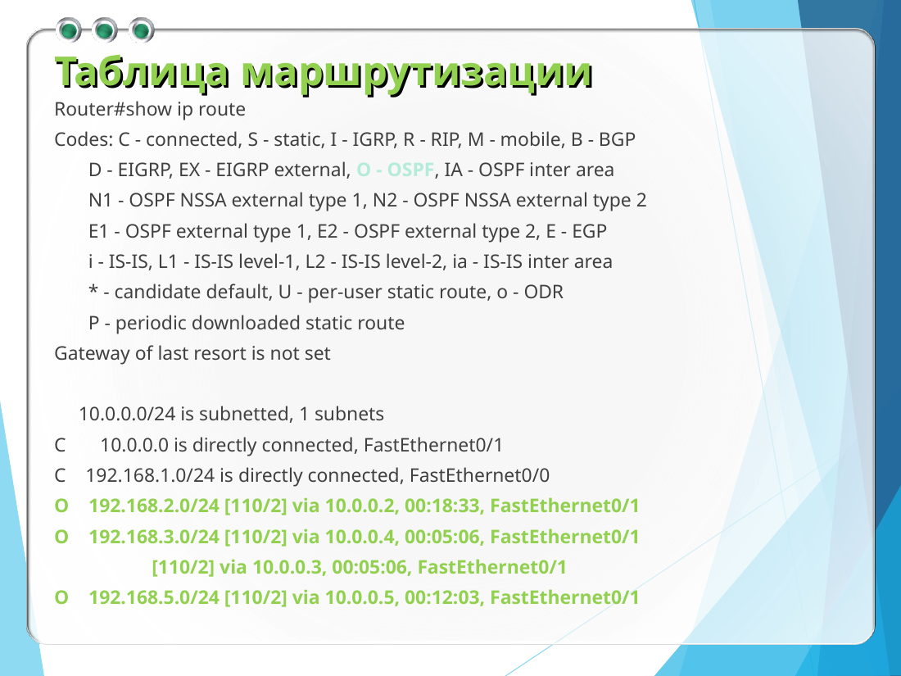
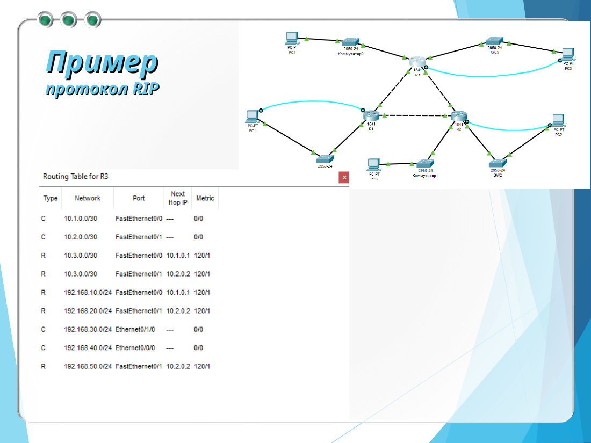
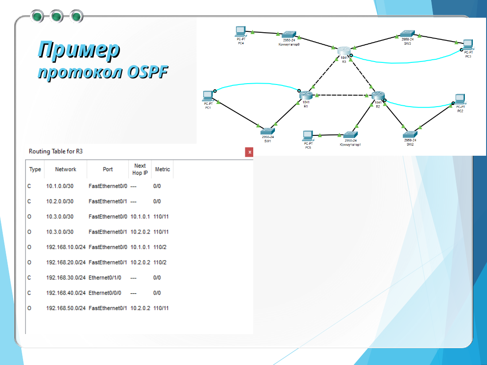

# Маршрутизация в Cisco

Маршрутизация — это и поиск пути, и сама пересылка. Таблица говорит, в какой интерфейс и к какому соседу отдать пакет. Маршрутизатор смотрит IP назначения и собирает кадр для следующего участка. Если записи нет, пакет не доставить.



От алгоритма ждут короткого пути, простоты, устойчивости, быстрой **сходимости** и гибкости. Сходимость — это момент, когда после обрыва все снова согласны насчёт маршрутов. Алгоритмы бывают статическими и динамическими, с одним путём или с несколькими, плоскими и иерархическими, внутри домена и между доменами. Метрика может считать переходы, надёжность, задержку и полосу.

## Что лежит в таблице

| Поле | Смысл |
| --- | --- |
| Сеть или узел | куда ведёт маршрут |
| Маска | размер сети, `/32` — один узел |
| Шлюз | адрес следующего маршрутизатора |
| Интерфейс | откуда отправлять |
| Метрика | числовая цена пути |

Записи приходят от своих интерфейсов, из статики, от протоколов и от служебных адресов. Бывают маршруты к узлу, к сети, по умолчанию, на петлю, на широковещание и на группу. Сначала берут самый точный префикс, потом маршрут по умолчанию. Если не подошло ничего, доставка срывается.

В Windows таблицу смотрят и правят так:

```text
route print
route print -4
route add 157.0.0.0 mask 255.0.0.0 157.55.80.1 metric 3 if 2
route change 157.0.0.0 mask 255.0.0.0 157.55.80.5 metric 2 if 2
route delete 157.0.0.0
```

Ключ `-p` сохраняет маршрут после перезагрузки, `-4` и `-6` выбирают версию IP. В таблице Unix флаг **U** — маршрут жив, **H** — это один узел, **G** — пакет уходит на шлюз, **D** — маршрут пришёл из ICMP Redirect. Поле Use считает прошедшие пакеты.





## Интерфейсы и статика

Каждый включённый интерфейс Cisco получает свой адрес и маску. Его сеть сама появляется в таблице как подключённая. Пока интерфейс в `shutdown` или без адреса, маршрута через него нет. На одном порту можно поднять подынтерфейсы и привязать их к разным VLAN: кадры тогда помечаются тегом 802.1Q.

Статический маршрут задаёт сеть, маску и следующий узел:

```text
enable
configure terminal
ip route 192.168.3.0 255.255.255.0 10.0.1.4
end
write memory
show ip route
```

Маршрут по умолчанию — сеть `0.0.0.0` с маской `0.0.0.0`. В Packet Tracer его добавляют и через Config → Routing → Static: поля Network, Mask и Next Hop. На учебной схеме пять маршрутизаторов 1841 и коммутатор 2950. Локальные сети компьютеров — `192.168.0.0/24`, `192.168.1.0/24`, `192.168.2.0/24` и `192.168.3.0/24`, шлюзы заканчиваются на `.1`. Транзитные сети между маршрутизаторами — `10.0.0.0/24` и `10.0.1.0/24`. Адреса концов одного кабеля нужно сверить со схемой: на слайдах они иногда подписаны наоборот.



## Как Cisco выбирает маршрут

Сначала побеждает самая длинная маска. При равной маске смотрят **административную дистанцию**: чем меньше, тем источнику больше верят. У одного протокола сравнивают метрику.

| Откуда маршрут | AD | Буква |
| --- | --- | --- |
| Подключённая сеть | 0 | C |
| Статика | 1 | S |
| IGRP | 100 | I |
| OSPF | 110 | O |
| RIP | 120 | R |

Строка `R 192.168.2.0/24 [120/1] via 10.0.0.2` — маршрут RIP, дистанция 120, метрика 1, следующий узел `10.0.0.2`. Звёздочка у `S*` помечает статику по умолчанию.





## RIP и OSPF на маршрутизаторе

RIP считает переходы алгоритмом Беллмана-Форда и шлёт обновления примерно раз в 30 секунд по UDP/520. Три минуты без вестей — маршрут считают мёртвым. Метрика 16 значит «недостижимо», поэтому протокол годится для небольшой сети. RIPv2 добавляет маски и аутентификацию. На маршрутизаторе перечисляют его собственные сети:



```text
router rip
network 10.0.0.0
network 192.168.1.0
version 2
```

Чужие сети в таблице появляются с буквой R. В симуляции у пакета RIP видны заголовки IP и UDP и список сетей с метрикой.

OSPF сходится быстрее: он строит дерево кратчайших путей Дейкстрой. Команда для сети `/24` использует обратную маску:

```text
router ospf 1
network 10.0.0.0 0.0.0.255 area 1
```

Число после `router ospf` — местный номер процесса, `area 1` — область. Области связывает магистраль area 0. Номер процесса у соседей может не совпадать. OSPF идёт поверх IP с номером протокола 89 и помечает маршруты буквой O.



**BGP** носит достижимость сетей между автономными системами по TCP/179. В таблице такие маршруты помечают буквой B. Соседи обмениваются сообщениями OPEN и UPDATE. На выбор пути влияют политика и local preference, затем длина AS_PATH.

На компьютере шлюзом ставят адрес того интерфейса маршрутизатора, который смотрит в сеть компьютера. Без шлюза узел не отправит пакет в чужую сеть, даже если маршрутизаторы уже настроены. Проверяют `show ip interface brief`, `ping` и `traceroute`.
