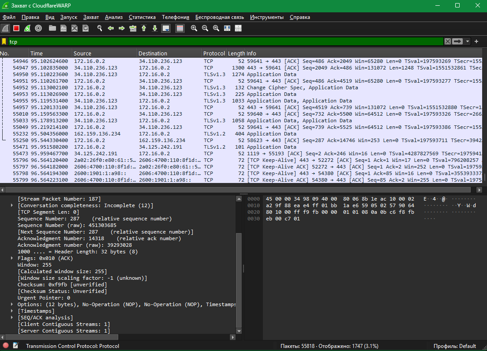
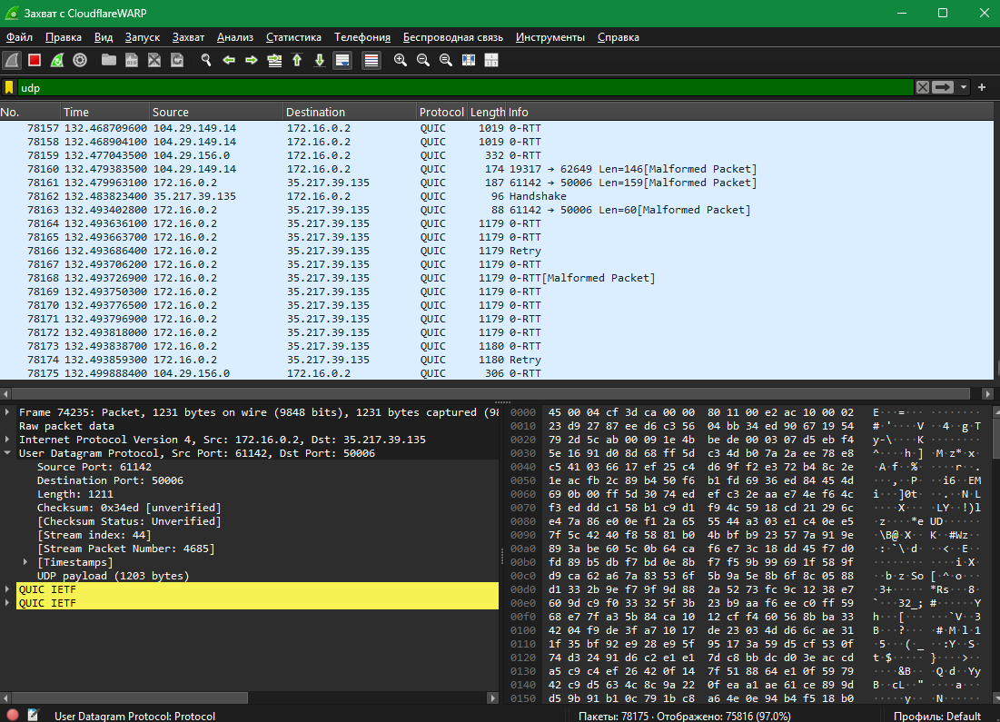

# Домашнее задание №11

Конспект: [Транспортный уровень TCP и UDP](<../class/Транспортный уровень TCP и UDP.md>).

Ниже скриншоты Wireshark из `homework/homework 19.10/`.

## TCP, флаги PSH и ACK

В выделенном сегменте видны флаги PSH и ACK, порты и номера последовательности.

## TCP, флаг ACK

В выделенном сегменте установлен флаг ACK.

## UDP

Внизу кадра разобран заголовок UDP: порт отправителя 61142, порт получателя 50006. Полезная нагрузка отмечена как QUIC.

