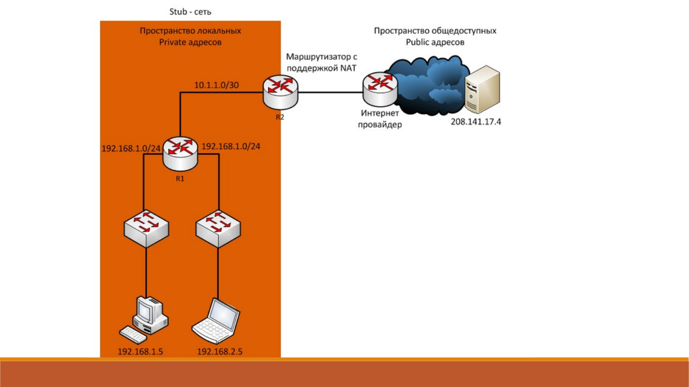
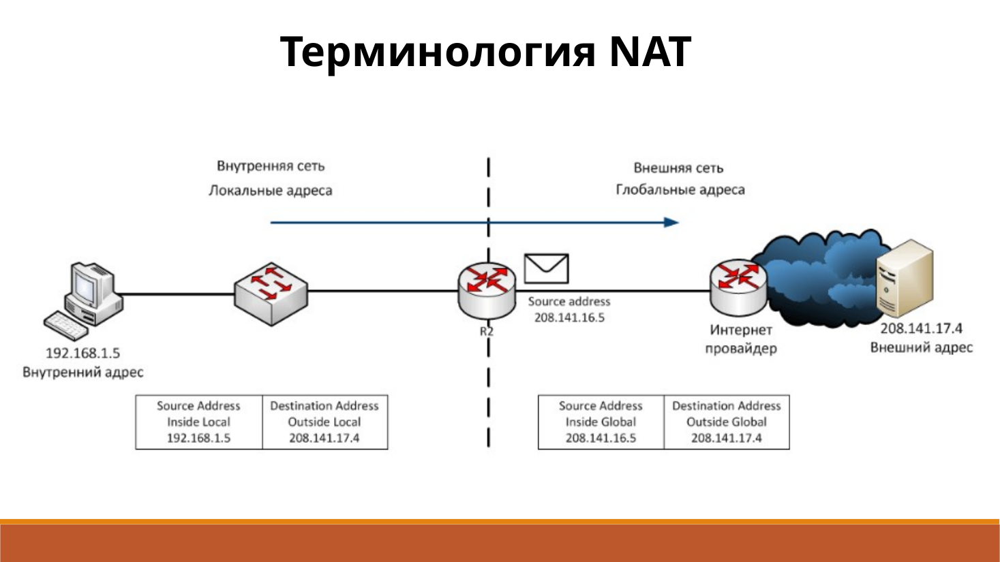
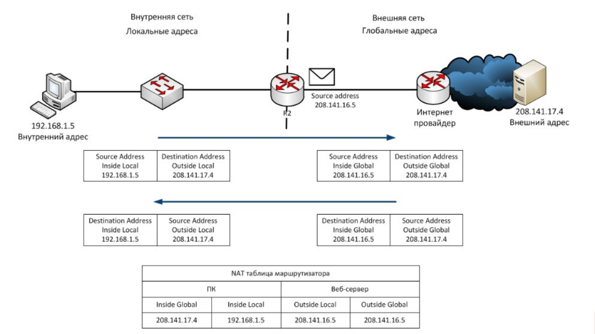
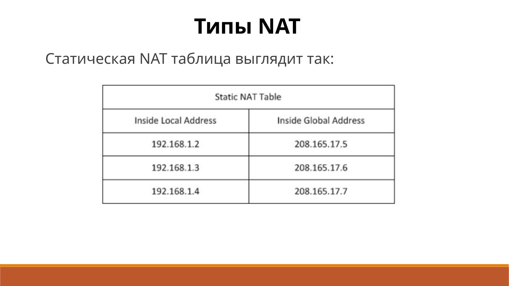
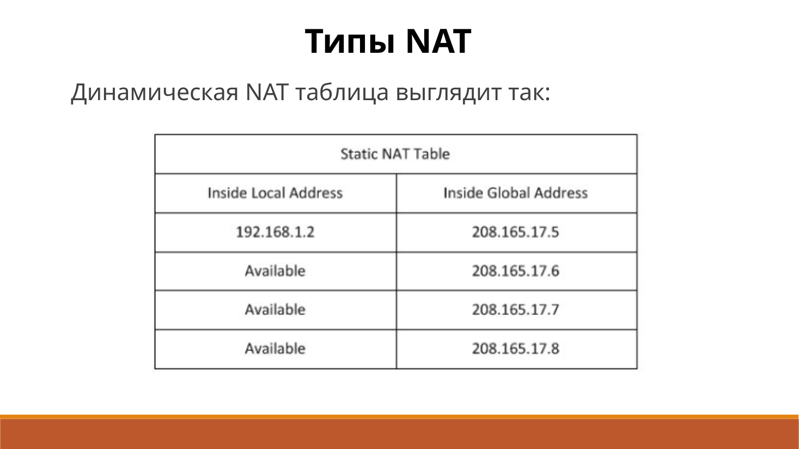
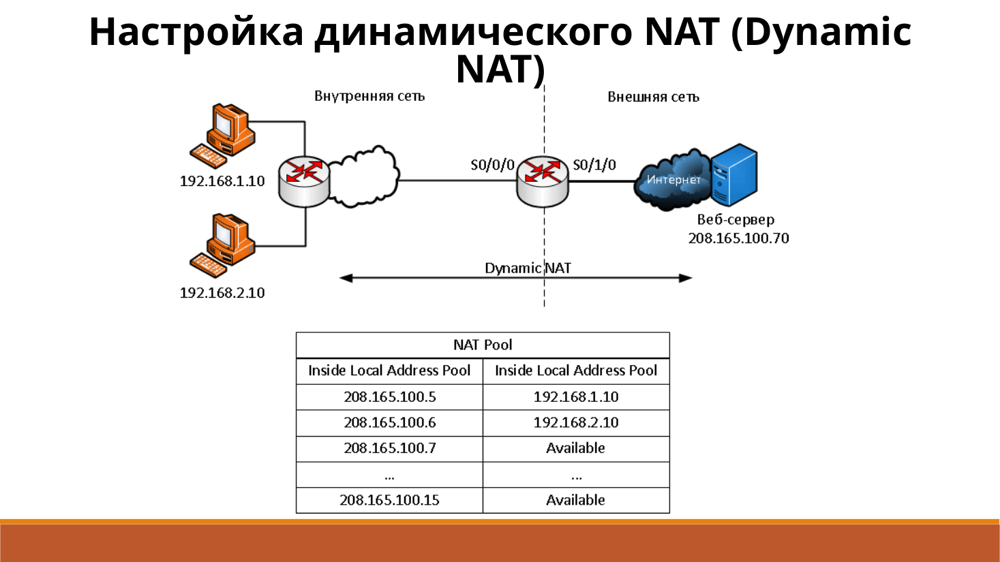
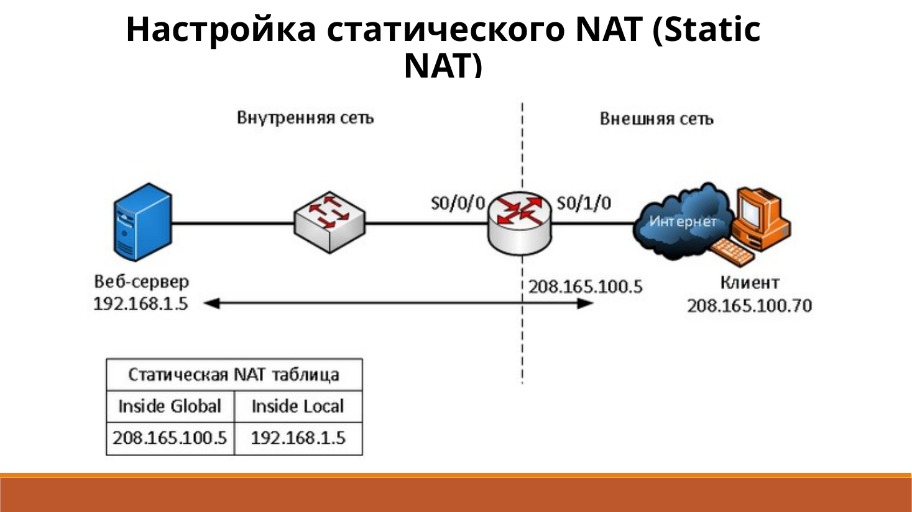
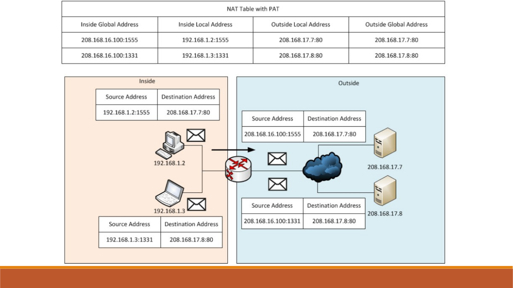
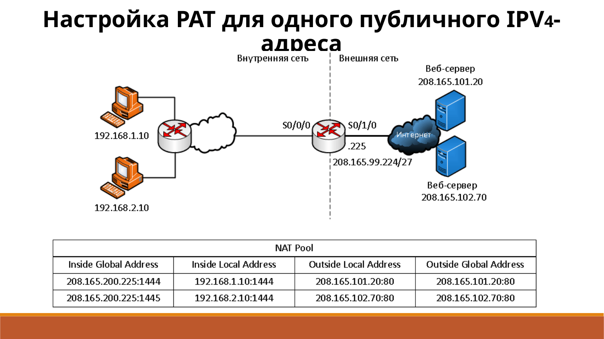

# Технология NAT

**NAT** подменяет адреса. Когда частный узел выходит в Интернет, пограничный маршрутизатор ставит вместо его адреса публичный. Так экономят IPv4, особенно если много узлов сидят на одном адресе через PAT. Долгосрочно нехватку адресов закрывает IPv6.

Внутри площадки используют `10.0.0.0/8`, `172.16.0.0/12` и `192.168.0.0/16`. В Интернет эти адреса сами не маршрутизируются. **Пул NAT** — набор публичных адресов, которыми маршрутизатор вправе подменять внутренние. Обычно NAT стоит на границе **stub-сети**: у неё один выход наружу.

## Четыре имени адреса

Inside и Outside говорят, своё это устройство или чужое. Local и Global — как адрес выглядит изнутри и снаружи.

| Имя | Что это | Пример |
| --- | --- | --- |
| Inside local | внутренний узел, как его видят свои | `192.168.1.5` |
| Inside global | тот же узел, как его видят снаружи | `208.141.16.5` |
| Outside local | внешний узел, как его видят изнутри | `208.141.17.4` |
| Outside global | внешний узел в своей сети | `208.141.17.4` |

Адрес внешнего сервера обычно не меняют, поэтому outside local и outside global совпадают.

Пакет идёт так. ПК `192.168.1.5` пишет серверу `208.141.17.4`. Маршрутизатор меняет источник на `208.141.16.5` и кладёт пару в таблицу NAT. Сервер отвечает на `208.141.16.5`. Маршрутизатор находит запись, возвращает адрес назначения `192.168.1.5` и отдаёт пакет ПК.

## Три вида

| Вид | Соответствие | Зачем |
| --- | --- | --- |
| Static NAT | один частный адрес навсегда связан с одним публичным | опубликовать внутренний сервер |
| Dynamic NAT | на время сеанса берут свободный адрес из пула | выпустить узлы наружу |
| PAT, или overload | много частных адресов на один или несколько публичных, сеансы различают портом | общий выход в Интернет |

Статические пары задаёт администратор, каждой нужен свой публичный адрес. Динамический NAT выдаёт адрес при появлении трафика и забирает его обратно, когда запись протухла. Пока пул занят, новый узел наружу не выйдет. Пример: `192.168.1.10` становится `208.165.100.5`, а `192.168.2.10` — `208.165.100.6`.

PAT помнит и адрес, и порт TCP или UDP. Исходный порт стараются сохранить. Если он занят, берут следующий свободный. Два ПК с портом `1444` после перевода выглядят как `208.165.99.225:1444` и `208.165.99.225:1445`. Ответ возвращают по этой записи, восстанавливая частный адрес и старый порт. У ICMP порта нет, поэтому берут идентификатор запроса.

## Польза и цена

PAT экономит публичные адреса. Внутреннюю нумерацию можно не менять при смене провайдера. Снаружи частные адреса не видны. NAT при этом не заменяет межсетевой экран.

Плата — лишняя обработка и задержка, потеря сквозной адресации и более трудная диагностика. Страдают VoIP, IPsec и входящие соединения, для которых заранее не сделали статическую запись. Трассировка через несколько переводов читается хуже.
