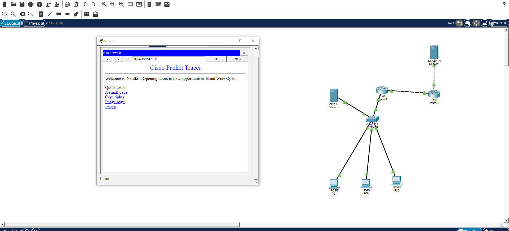

# Домашнее задание №12

В Cisco Packet Tracer открыт веб-сервер по адресу `http://213.234.10.2`. На схеме компьютеры подключены к коммутатору, дальше два маршрутизатора и два сервера.

Презентации:

- [nat теор.pptx](<../class/nat теор.pptx>)
- [nat в cisco.pptx](<../class/nat в cisco.pptx>)

Исходный файл: `homework/homework 12.10/Снимок экрана 2026-10-13 011772.png`.
