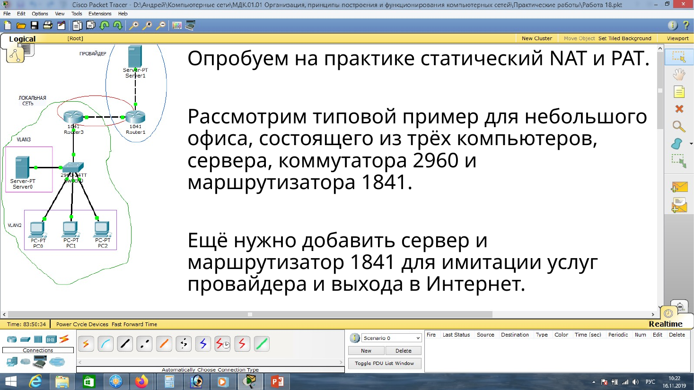
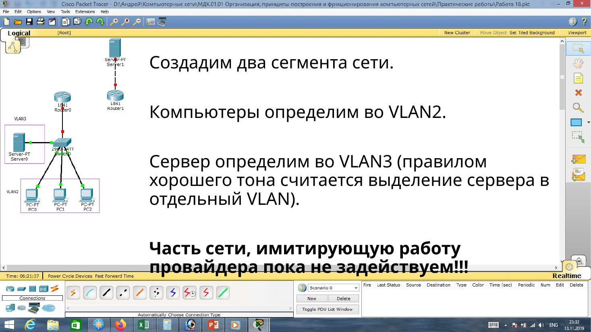
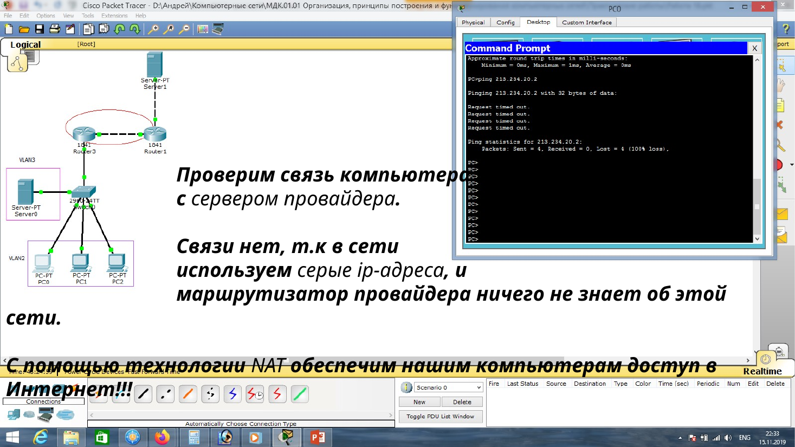
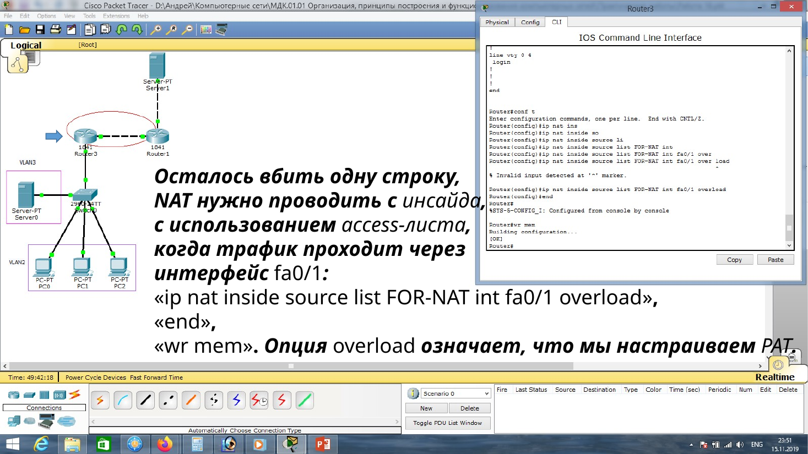
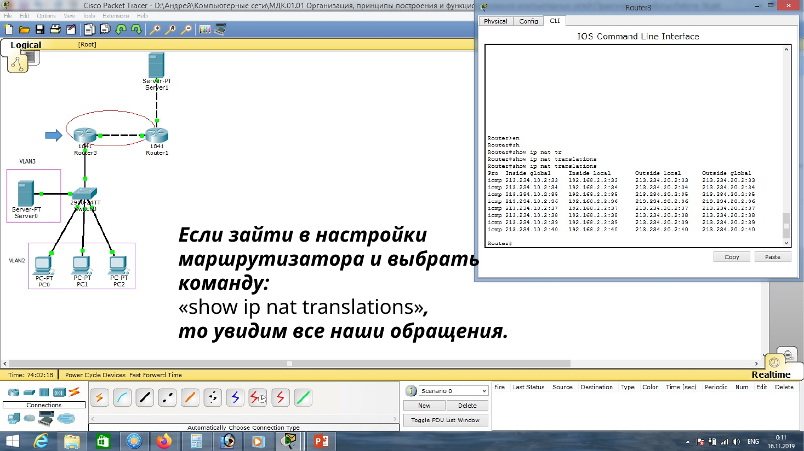
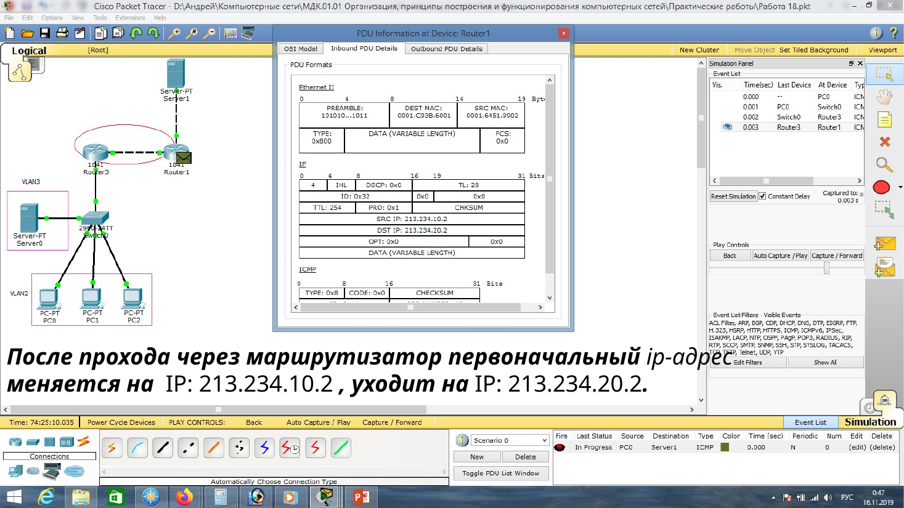
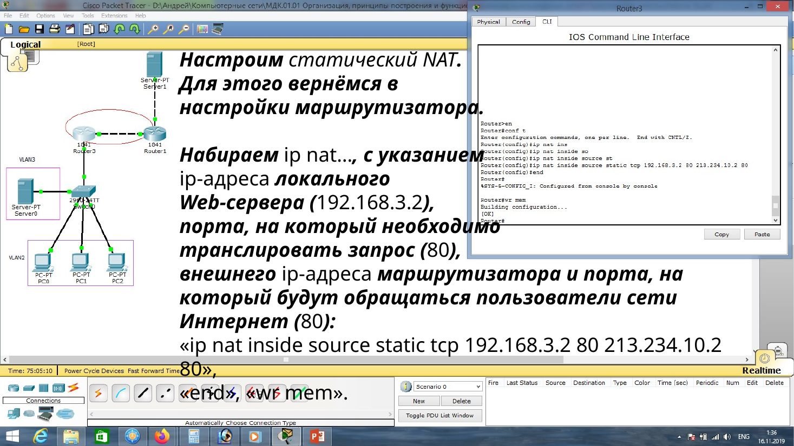
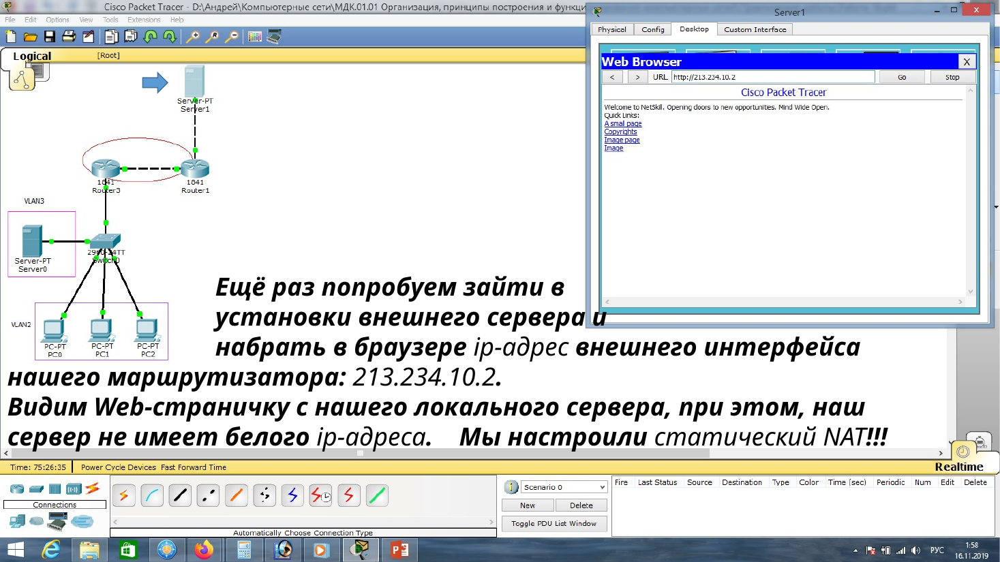

# NAT в Cisco

В типовой схеме офиса три компьютера, сервер, коммутатор 2960 и маршрутизатор 1841. Компьютеры сажают в одну VLAN, сервер — в другую. Порты доступа коммутатора переводят в свою VLAN, порт к маршрутизатору делают транковым.





На маршрутизаторе порт в сторону коммутатора делят на подынтерфейсы. Каждый получает адрес шлюза своей VLAN и метку 802.1Q. После этого компьютеры пингуют свой шлюз и сервер.

## Граница NAT

Для любого вида NAT интерфейсы помечают относительно границы. В учебном примере `Serial0/0/0` смотрит внутрь, `Serial0/1/0` — наружу:

```text
interface serial0/0/0
ip nat inside
exit
interface serial0/1/0
ip nat outside
exit
```

Второй интерфейс офисного маршрутизатора получает публичный адрес провайдера. Соседний адрес стоит на маршрутизаторе провайдера. Пока NAT выключен, сам офисный маршрутизатор провайдера пингует, а компьютер с частным адресом до внешнего сервера не доходит.



## Статика, динамика и PAT

Постоянная пара для внутреннего сервера:

```text
ip nat inside source static 192.168.1.5 208.165.100.5
```

Динамический пул связывают со списком доступа. Обратная маска `0.0.255.255` у `192.168.0.0/16` означает: первые два октета проверяют, последние два могут быть любыми.

```text
ip nat pool NAT_POOL 208.165.100.5 208.165.100.15 netmask 255.255.255.0
access-list 1 permit 192.168.0.0 0.0.255.255
ip nat inside source list 1 pool NAT_POOL
```

Для PAT к той же связке добавляют `overload`. Если публичный адрес один, вместо пула указывают внешний интерфейс:



```text
ip nat inside source list 1 pool NAT_POOL overload
ip nat inside source list 1 interface serial0/1/0 overload
```

Пакет уходит наружу уже с публичным источником. `show ip nat translations` показывает пару частного адреса и порта с публичным адресом и портом. На обратном пути перевод снимается.





| Команда | Что показывает или делает |
| --- | --- |
| `show ip nat translations` | таблица переводов |
| `show ip nat translations verbose` | подробности записей |
| `show ip nat statistics` | счётчики, интерфейсы, занятость пула |
| `show access-lists` | сработал ли список доступа |
| `clear ip nat statistics` | обнулить счётчики перед проверкой |
| `clear ip nat translation *` | стереть динамические записи, живые сеансы могут оборваться |

Статику убирают из конфигурации командой `no ip nat inside source static` с теми же адресами. Динамические строки появляются сами, когда проходит подходящий трафик.

## Веб-сервер извне

Одной перегрузки мало, если снаружи должны открыть внутренний сайт: внешний узел не знает частный адрес. Статическая запись направляет обращения на публичный адрес маршрутизатора на адрес сервера и порт HTTP. Страницу сервера в Packet Tracer можно заменить своей. Проверка — открыть в браузере внешнего узла адрес внешнего интерфейса, например `213.234.10.2`.




