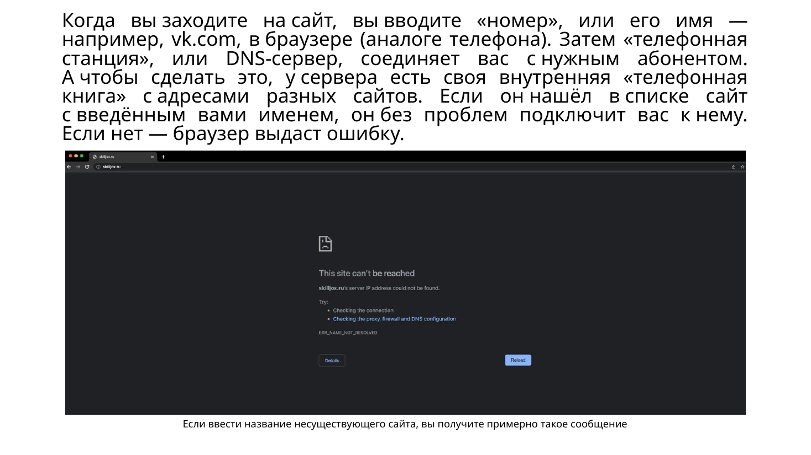
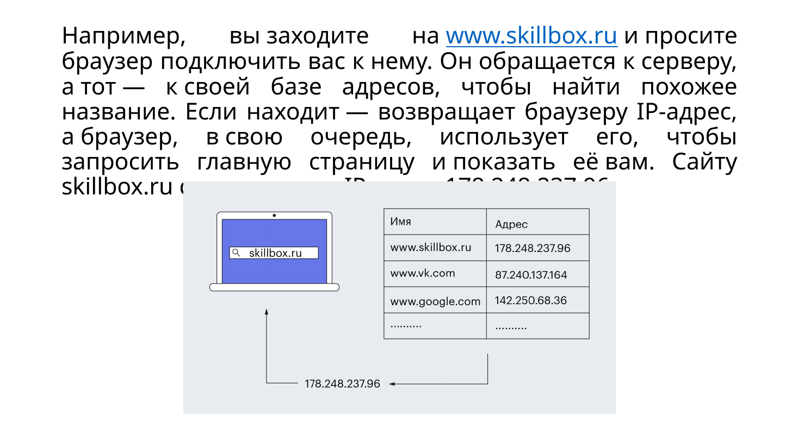
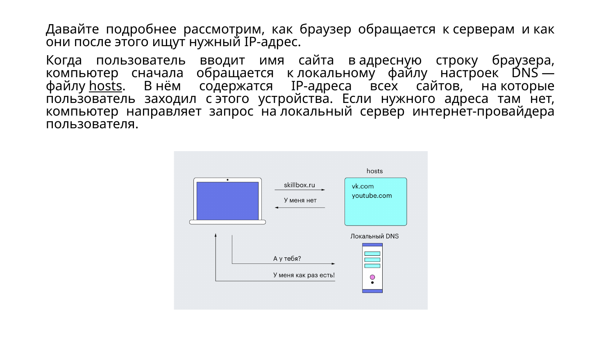
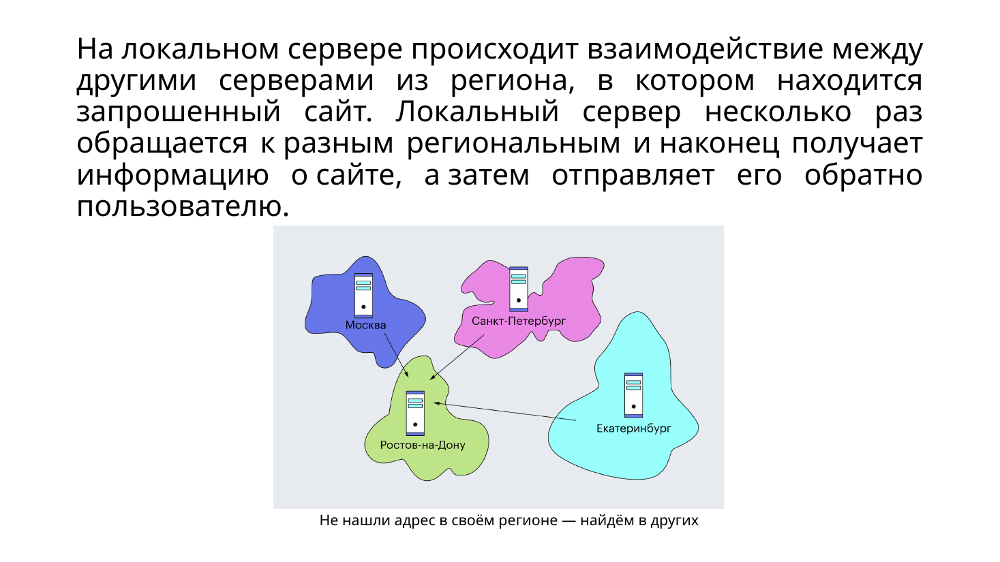
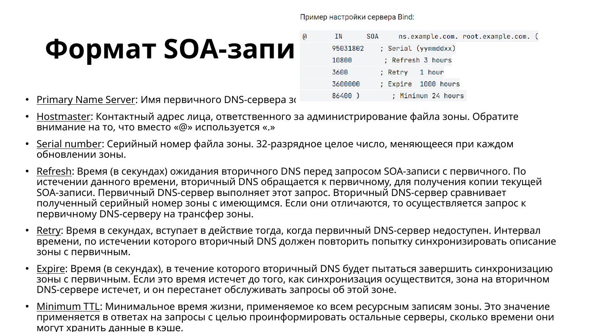
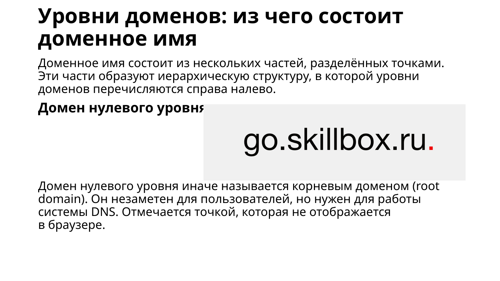
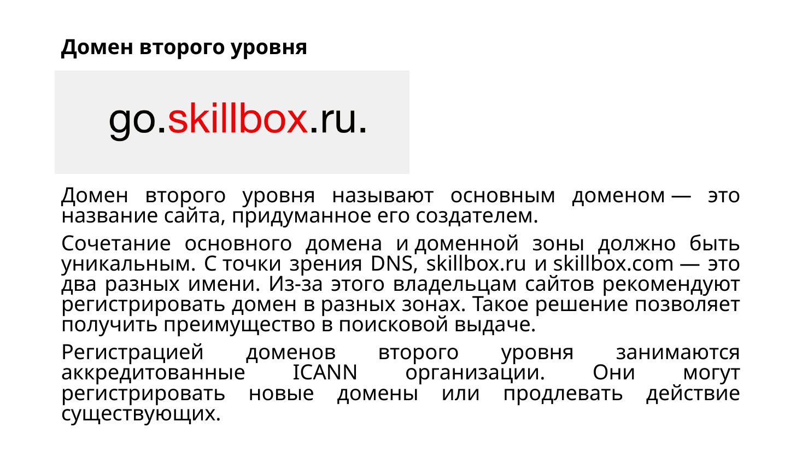
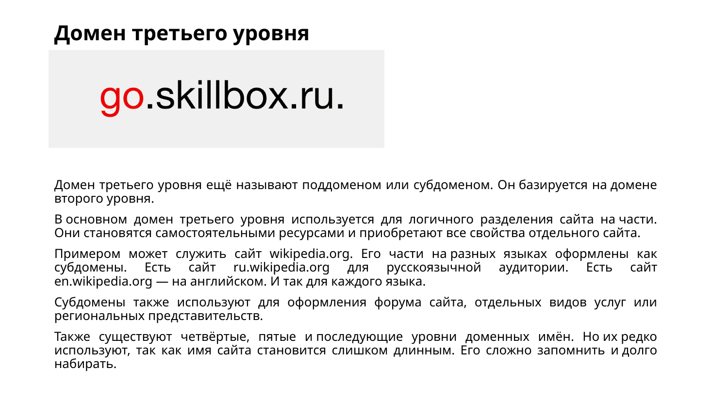

# Система доменных имён DNS

**DNS** переводит имя в IP-адрес. Имя удобно человеку, адрес нужен компьютеру, чтобы открыть соединение. Раньше соответствия держали в общем файле `HOSTS.TXT`. Сеть выросла, и один файл перестал справляться. DNS устроена как телефонная книга: ввели имя — система нашла номер. Адреса на схемах — учебные примеры, в другой сети они другие.

## Кто отвечает на запрос

Серверы хранят записи своей части системы или ненадолго помнят чужие ответы.

- **Резолвер** ищет ответ для клиента. Его даёт провайдер или публичная служба.
- **Корневые серверы** показывают, где лежат зоны верхнего уровня, например `.ru` и `.com`.
- **Серверы верхнего уровня** отправляют к серверам конкретного домена.
- **Авторитетный сервер** хранит записи своей зоны и отвечает за неё.

Если в кэше готового ответа нет, цепочка такая:

1. Человек вводит имя в браузере.
2. Компьютер смотрит файл `hosts` и свой DNS-кэш. В `hosts` пары прописывают вручную.
3. Запрос уходит настроенному резолверу.
4. Резолвер спрашивает корень, затем сервер зоны верхнего уровня, затем авторитетный сервер домена.
5. Адрес возвращается клиенту. Браузер открывает веб-сервер и забирает страницу.

Если домена нет или адрес не получили, браузер показывает ошибку.

## Кэш и свойства системы

Кэш хранит ответ ненадолго. Повторный запрос идёт быстрее и меньше тревожит остальные серверы. **TTL** говорит, сколько ответ можно помнить. Когда срок вышел, его спрашивают снова. После смены адреса клиенты ещё какое-то время видят старый, пока кэш жив.

Зоны ведут разные организации: и управление, и хранение распределены. Домены образуют дерево, ответственность за ветку можно отдать другому серверу. Одну зону держат несколько серверов, чтобы отказ одного не погасил имя.

У корневых серверов **13 имён**, за каждым — много копий по миру. Они знают корневую зону и то, кому делегированы домены верхнего уровня.

## Зона и записи

**Зона** — кусок пространства имён, за который отвечает набор серверов. Данные в ней — ресурсные записи.

| Запись | Что хранит |
| --- | --- |
| A | IPv4-адрес имени |
| MX | почтовый сервер домена |
| CNAME | псевдоним другого имени |
| NS | авторитетный сервер зоны |
| TXT | текст, в том числе правила почты |
| SOA | паспорт зоны и таймеры обновления |

**SPF** перечисляет, каким серверам можно слать почту от имени домена. Эти правила кладут в TXT.

**SOA** нужна, чтобы копии зоны не разъехались.

| Поле | Смысл |
| --- | --- |
| Primary Name Server | главный сервер зоны |
| Hostmaster | почта администратора, вместо `@` ставят точку |
| Serial | номер версии, его меняют при правке |
| Refresh | как часто вторичный сервер проверяет обновление |
| Retry | пауза после неудачной проверки |
| Expire | сколько можно жить без успешного обновления |
| Minimum | сколько кэшировать ответ «такого имени нет» |

Интервалы пишут в секундах.

## Уровни имени

Имя читают справа налево. В `go.skillbox.ru` последняя ненаписанная точка — корень, `ru` — первый уровень, `skillbox` — второй, `go` — третий, то есть поддомен.

Верхний уровень бывает национальным, например `.ru`, `.de`, `.uk`, и общим, например `.com`, `.org`, `.info`. `skillbox.ru` и `skillbox.com` — разные имена. Поддомены отделяют разделы: `ru.wikipedia.org` и `en.wikipedia.org`. Бывает и четвёртый уровень.

## Протокол

DNS сидит на прикладном уровне OSI. Протокол задаёт вид запроса и ответа, серверы хранят записи. **DNSSEC** добавляет проверку подлинности и целостности, чтобы подмену ответа было видно.
