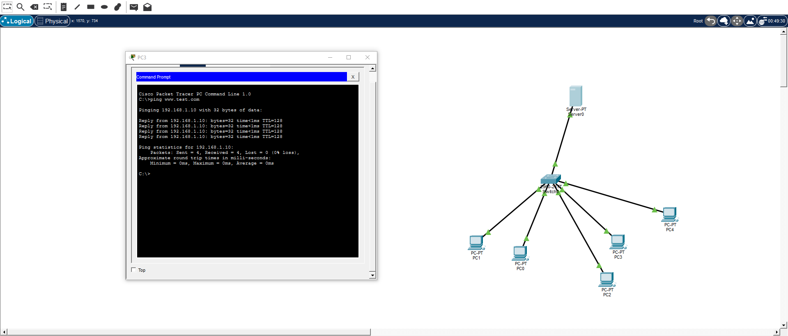

# Домашнее задание 14.10

Урок 15. Проверить разрешение имени в Cisco Packet Tracer. С PC1 выполнен `ping www.test.com`, ответы приходят от `192.168.1.10`. На схеме сервер и четыре компьютера подключены к одному коммутатору.

Исходный файл лежал в `homework/homework14.10(2)/`.

