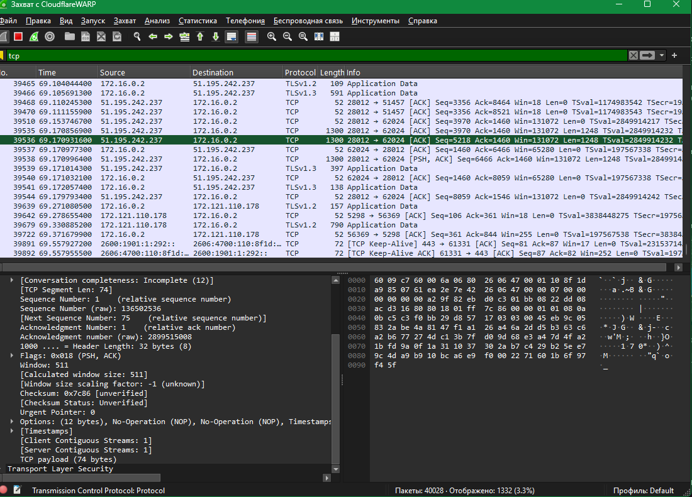

# Домашнее задание 19.10

Урок 16. Три захвата Wireshark: два кадра TCP с разными флагами и один кадр UDP.

Исходные файлы лежали в `homework/homework 19.10/`.

## TCP: флаги PSH и ACK

В выделенном сегменте установлены PSH и ACK. Видны порты, номера последовательности и подтверждения.

## TCP: флаг ACK

В выделенном сегменте установлен флаг ACK, окно и номера подтверждения раскрыты в дереве протокола.

## UDP

Фильтр `udp`. В дереве кадра порт источника `61142`, порт назначения `50006`, дальше полезная нагрузка отмечена как QUIC.

